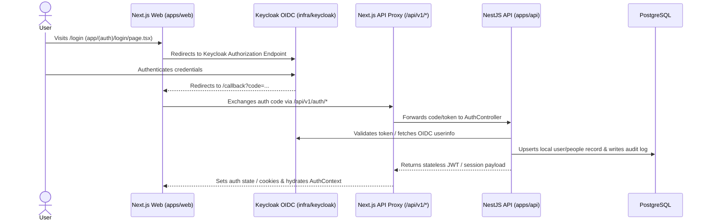

# Authentication & Authorization Architecture Specification

> **Document Status:** Consolidated Reference (Synced with Monorepo Structure)  
> **Related Existing Docs:**
> - `docs/adr/0004-keycloak-self-hosted-oidc-stateless-jwt.md` (Identity Provider & Token Strategy)
> - `docs/onboarding_and_verification_specification.md` (Registration, Onboarding & Verification Rules)
> - `docs/rbac_and_frontend_matrix.md` (Role Permissions & UI Route Matrix)
> - `docs/database_design_specification.md` (Users, People, Outbox & Audit Schemas)

---

## 1. Overview

The **College Management System** implements a **hybrid OIDC + Stateless JWT authentication architecture** combined with **Role-Based Access Control (RBAC)** and **Row-Level Security Scoping** across a TypeScript monorepo (`apps/api`, `apps/web`, `apps/worker`, and `packages/*`).

Unlike monolithic session-only setups, identity and mail-based verification are split across four layers:

1. **Identity Provider (`infra/keycloak/`):** Self-hosted Keycloak instance configured via `infra/keycloak/realm-export.json` for OpenID Connect (OIDC) login, token issuance, and identity federation.
2. **Backend API Auth Module (`apps/api/src/modules/auth/`):** NestJS authentication endpoints, user/profile provisioning, verification token handling, and JWT/RBAC enforcement.
3. **Frontend Auth & BFF Layer (`apps/web/`):** Next.js App Router authentication pages (`(auth)/login`, `(auth)/register`, `(auth)/signup`, `(auth)/callback`) and a server-side API proxy (`app/api/v1/[...slug]/route.ts`).
4. **Asynchronous Mail/Notification Dispatch (`apps/worker/`):** Transactional Outbox pattern (`outbox` table $\rightarrow$ `outbox-consumer.ts` $\rightarrow$ `notification.processor.ts`) for reliable email/SMS verification and onboarding notifications.

---

## 2. Repository Map for Auth & Verification

| Layer | File / Directory Path | Responsibility |
| :--- | :--- | :--- |
| **IdP Config** | `infra/keycloak/realm-export.json` | Keycloak realm, OIDC clients, redirect URIs, and role definitions |
| **API Auth Module** | `apps/api/src/modules/auth/auth.module.ts` | Registers `AuthController` and `AuthService` within NestJS |
| **API Auth Controller** | `apps/api/src/modules/auth/controllers/auth.controller.ts` | Exposes login, registration, callback/token exchange, and verification endpoints |
| **API Auth Service** | `apps/api/src/modules/auth/services/auth.service.ts` | Core authentication, account creation, Keycloak sync, and verification workflows |
| **JWT & Role Guards** | `apps/api/src/shared/guards/jwt.guard.ts` `apps/api/src/shared/guards/roles.guard.ts` | Validates Bearer JWTs and enforces `@Roles(...)` metadata on routes |
| **Auth Decorators** | `apps/api/src/shared/decorators/current-user.decorator.ts` `apps/api/src/shared/decorators/roles.decorator.ts` `apps/api/src/shared/decorators/row-scope.decorator.ts` | Injects authenticated user context, required roles, and row-level scope rules |
| **Row-Scope Middleware** | `apps/api/src/shared/middleware/row-scope.middleware.ts` | Restricts data access by institution/department/student/staff ownership |
| **Audit & Outbox** | `apps/api/src/shared/audit/audit.service.ts` `apps/api/src/shared/outbox/outbox.service.ts` | Persists security audit trails and queues async verification emails |
| **Worker Notification** | `apps/worker/src/shared/outbox-consumer.ts` `apps/worker/src/processors/notification.processor.ts` | Polls outbox events and dispatches email/SMS verification messages |
| **Shared Role Types** | `packages/shared/src/types/roles.ts` | Canonical role enums shared across `api`, `web`, and `worker` |
| **Database Schemas** | `packages/database/src/schema/people.ts` `packages/database/src/schema/outbox.ts` `packages/database/src/schema/audit.ts` | Drizzle ORM schemas for users/students/staff, outbox events, and audit logs |
| **Web Auth Pages** | `apps/web/src/app/(auth)/login/page.tsx` `apps/web/src/app/(auth)/register/page.tsx` `apps/web/src/app/(auth)/signup/page.tsx` `apps/web/src/app/(auth)/callback/page.tsx` | Login UI, multi-step registration/verification UI, signup redirect, and OIDC callback handler |
| **Web Auth State & Proxy** | `apps/web/src/lib/auth.ts` `apps/web/src/lib/auth-context.tsx` `apps/web/src/app/api/v1/[...slug]/route.ts` | Client auth state provider, token/cookie helpers, and Next.js BFF API proxy |

---

## 3. End-to-End Authentication Flows

### 3.1 OIDC Sign-In & Callback Flow

### 3.2 Registration & Mail Verification Flow (Transactional Outbox Pattern)

To guarantee that verification emails are never lost if an SMTP server or external provider temporarily fails, email verification uses the **Transactional Outbox** (`ADR-0003`):

1. **Registration Submission (`apps/web/src/app/(auth)/register/page.tsx`):**
   - User submits registration details (role, email, institutional identifier, profile metadata).
   - Request is routed through `apps/web/src/app/api/v1/[...slug]/route.ts` to `AuthController` (`apps/api/src/modules/auth/controllers/auth.controller.ts`).
2. **Atomic Account + Outbox Write (`apps/api/src/modules/auth/services/auth.service.ts`):**
   - Within a single PostgreSQL transaction (`packages/database`), `AuthService` creates the pending user/person record (`packages/database/src/schema/people.ts`), generates a verification token/link, and inserts a notification event into the `outbox` table (`packages/database/src/schema/outbox.ts`) via `OutboxService`.
3. **Background Email Dispatch (`apps/worker/`):**
   - `outbox-consumer.ts` polls unprocessed outbox rows and routes notification events to `notification.processor.ts`.
   - The worker sends the verification email (or SMS via the deduplicated gateway in `ADR-0010`) and marks the outbox event as processed.
4. **Verification Confirmation:**
   - User clicks the verification link or submits the verification code, hitting `AuthController` $\rightarrow$ `AuthService`, which validates the token, marks the user/Keycloak account as verified, and records an entry via `AuditService`.

> **Action Item for Code Sync:** Verify the exact route paths (e.g., `/auth/register`, `/auth/verify-email`, `/auth/resend-verification`, `/auth/callback`) and DTO field names directly against `apps/api/src/modules/auth/controllers/auth.controller.ts` and `docs/onboarding_and_verification_specification.md`.

---

## 4. Authorization, RBAC & Row-Level Scoping

Every protected endpoint in `apps/api` passes through a multi-stage security pipeline:

1. **Authentication (`JwtGuard` — `apps/api/src/shared/guards/jwt.guard.ts`):**
   - Extracts and verifies the JWT signature against Keycloak's JWKS / configured secret (`.env.example`).
   - Attaches the decoded user payload to the request, accessible in controllers via `@CurrentUser()` (`current-user.decorator.ts`).
2. **Role Authorization (`RolesGuard` — `apps/api/src/shared/guards/roles.guard.ts`):**
   - Reads `@Roles(...)` metadata (`roles.decorator.ts`) and compares against the user's assigned roles defined in `packages/shared/src/types/roles.ts`.
   - Mirrors frontend route visibility rules documented in `docs/rbac_and_frontend_matrix.md`.
3. **Tenant & Row-Level Scoping (`RowScopeMiddleware` — `apps/api/src/shared/middleware/row-scope.middleware.ts`):**
   - Works with `@RowScope()` (`row-scope.decorator.ts`) to ensure non-admin users (e.g., students, faculty, department staff) can only query or mutate records belonging to their own scope.
4. **Audit Logging (`AuditService` — `apps/api/src/shared/audit/audit.service.ts`):**
   - Records sensitive authentication, role-change, and verification events into `packages/database/src/schema/audit.ts` with the request correlation ID (`request-id.middleware.ts`).

---

## 5. Database Schema & Migration Workflow

Unlike SQLx-based Rust services, this project manages schema evolution in **`packages/database`** using **Drizzle ORM**:

- **Schema Definitions:** `packages/database/src/schema/*.ts` (`people.ts`, `outbox.ts`, `audit.ts`, `academic.ts`, `attendance.ts`, `finance.ts`, `leave.ts`, `notice.ts`, `payroll.ts`).
- **Migration Config & SQL Output:** Configured in `packages/database/drizzle.config.ts`, outputting versioned SQL migrations to `packages/database/src/migrations/` (starting at `0000_init.sql`) plus container bootstrap SQL in `infra/docker/postgres/init.sql`.
- **When Updating Auth Fields:**
  1. Update columns/indexes in `packages/database/src/schema/people.ts` (and `outbox.ts` / `audit.ts` if new event types are added).
  2. Generate a new Drizzle migration under `packages/database/src/migrations/`.
  3. Update shared Zod validation schemas in `packages/shared/src/schemas/people.schema.ts` and `common.schema.ts`.
  4. Sync `docs/database_design_specification.md` and this document.

---

## 6. Environment Variables Checklist

Ensure the following variable groups (defined in `.env.example`) are configured across `apps/api`, `apps/web`, and `apps/worker`:

- **Keycloak / OIDC:** Issuer URL, Realm name (`realm-export.json`), Client ID, Client Secret, and Callback Redirect URI (`/callback`).
- **JWT Verification:** JWKS URI / Public Key, Audience, and Token Expiration settings.
- **Database & Redis:** PostgreSQL connection URL (`packages/database/src/client.ts`) and Redis URL (`apps/api/src/shared/redis/redis.provider.ts`).
- **Mail / Notification Transport:** SMTP host/port/credentials (or transactional email API key) and `FROM` address used by `apps/worker/src/processors/notification.processor.ts`.

---

## 7. Documentation Maintenance & Finishing Checklist

Before marking the authentication module complete, verify alignment across all docs:

- [x] **Endpoint & DTO Parity:** Confirm all routes in `apps/api/src/modules/auth/controllers/auth.controller.ts` match Section 3.
- [x] **Verification Rules:** Reconcile token TTL, resend cooldowns, and institutional approval steps with `docs/onboarding_and_verification_specification.md`.
- [x] **RBAC Matrix Parity:** Verify role names in `packages/shared/src/types/roles.ts` match `infra/keycloak/realm-export.json` and `docs/rbac_and_frontend_matrix.md`.
- [x] **Frontend Callback & Error States:** Confirm `/login`, `/register`, `/signup`, and `/callback` handle expired/invalid verification tokens gracefully.
