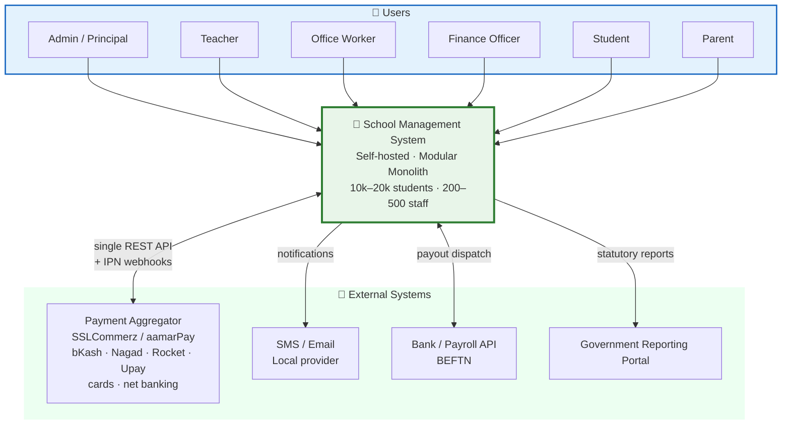
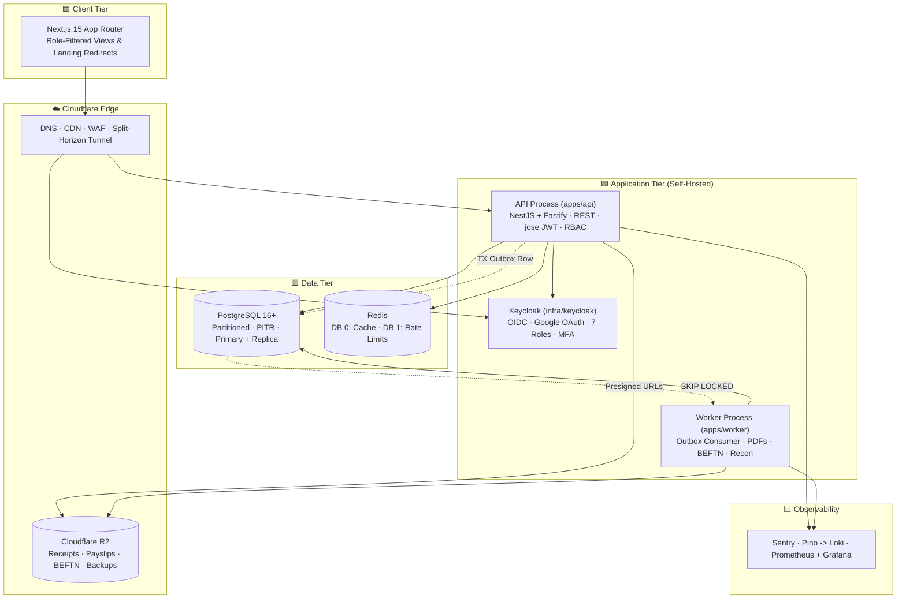

# 🏫 School Management System — Master Project Outline

**Version:** 2.2 (Unified Enterprise Edition)
**Status:** Active Execution — Architecture & RBAC Routing Locked
**Owner:** Lead Architect / Project Lead

---

## 1. Project Overview & Scale

An enterprise-grade, self-hosted **School & College Management System** for a single institution in Bangladesh, built as an **Nx Modular Monolith** (`NestJS + Fastify`, `Next.js 15`, `PostgreSQL 16+`, `Keycloak`, `Cloudflare R2`).

| Dimension | Target Scale |
| :--- | :--- |
| **Students** | 10,000 – 20,000 |
| **Staff** | 200 – 500 |
| **Attendance Rows / Year** | ~4M (daily mode) to ~24M (per-period mode) |
| **Payment Volume / Year** | ~40,000 – 60,000 transactions (MFS + Cards + Cash) |
| **Payroll Lines / Month** | 200 – 500 staff |
| **Peak Concurrency / RPS** | 300 – 800 concurrent users · 50 – 150 req/sec (p95 < 500ms) |
| **Out of Scope** | Multi-tenant SaaS, microservices, Kafka/RabbitMQ, event sourcing |

---

## 2. Ten Non-Negotiable Architectural Invariants

| # | Invariant | Technical Enforcement |
| :--- | :--- | :--- |
| **1** | **PostgreSQL is the single source of truth.** | All caches and search indexes are derived from Postgres. |
| **2** | **Redis failure degrades speed, never correctness.** | Stateless JWTs (`jose`); zero sessions or job queues in Redis. |
| **3** | **No dual writes.** | Domain writes and `outbox.job` rows commit in one ACID transaction. |
| **4** | **Search returns IDs; Postgres returns rows.** | `search` endpoints return UUIDs only; repositories apply `RowScope`. |
| **5** | **Upgrades require measured triggers.** | e.g., Meilisearch is added only if Bangla FTS spike fails recall. |
| **6** | **S3-compatible artifact storage via signed URLs.** | PDFs and BEFTN files stream directly to/from Cloudflare R2. |
| **7** | **Idempotent handlers & reclaimable outbox rows.** | `dedupe_key` + `FOR UPDATE SKIP LOCKED` + visibility timeout reclaimer. |
| **8** | **Financial ledger is strictly append-only.** | SQL triggers & DB grants block `UPDATE`/`DELETE` on `finance.ledger_entry`. |
| **9** | **Payroll reads only approved `period_close` snapshots.** | `sms_payroll_reader` role lacks `SELECT` on `attendance.period_event`. |
| **10** | **Audit log is append-only.** | SQL triggers & `INSERT`-only DB grants protect `audit.log`. |

---

## 3. System Architecture & Bounded Contexts

### 3.1 Container Architecture






### 3.2 Canonical Repository Layout (`sms-monorepo`)

*(Synchronized with `docs/project layout.md`)*

```text
sms-monorepo/
├── apps/
│   ├── api/src/
│   │   ├── modules/{academic,attendance,auth,finance,leave,notice,payroll,people,search}/
│   │   └── shared/{audit,database,decorators,guards,interceptors,middleware,outbox,pipes,redis,s3}/
│   ├── worker/src/
│   │   ├── processors/{beftn-dispatch,notification,payment-reconcile,payroll-compute,pdf-generation}.processor.ts
│   │   └── shared/{logger,outbox-consumer}.ts
│   └── web/src/
│       ├── app/(auth)/login/
│       ├── app/(dashboard)/{academic,attendance,attendance/period-close,finance,leave,notices,payroll,staff,students}/
│       ├── actions/
│       ├── components/{shared,ui}/
│       └── lib/{api-client,auth,rbac,utils}.ts
├── packages/
│   ├── database/src/{client.ts,index.ts,migrations/,schema/}
│   └── shared/src/{index.ts,schemas/,types/}
└── infra/{docker,grafana,keycloak,prometheus}/
```

---

## 4. Database Schemas & Security Enforcement

| Schema | Tables / Views | Enforcement |
| :--- | :--- | :--- |
| **`academic`** | `academic_year`, `term`, `class`, `section`, `subject`, `teacher_section` | Foreign keys + audit triggers |
| **`people`** | `student`, `staff`, `enrollment` | `pg_trgm` GIN indexes + `RowScope` filtering |
| **`attendance`** | `period_event` (range-partitioned), `daily_summary` (MatView), `correction_request`, `period_close` | `maker_neq_checker` constraint; `sms_payroll_reader` blocked from `period_event` |
| **`leave`** | `calendar_day`, `leave_type`, `leave_request`, `substitution` | Maker-Checker approval |
| **`finance`** | `ledger_entry`, `fee_schedule`, `invoice`, `payment`, `adjustment`, `reconciliation_run` | Append-only trigger (`NO UPDATE/DELETE`) + unique `idempotency_key` |
| **`payroll`** | `payroll_run`, `payroll_line`, `dispatch_batch`, `payslip` | `maker_neq_checker` constraint + immutable lines post-approval |
| **`notice`** | `notice` | `tsvector` GIN full-text index |
| **`outbox`** | `job` | `UNIQUE(dedupe_key)` + `FOR UPDATE SKIP LOCKED` |
| **`audit`** | `log` | Append-only trigger + `INSERT`-only DB grant |

---

## 5. Critical Business Flows

### 5.1 Attendance -> Period Close -> Payroll Gate
1. **Capture (`F-3.1`, `F-3.2`):** Teachers submit `POST /api/v1/attendance/batch` or LAN devices push HMAC-signed `POST /api/v1/attendance/device`. Events commit to `attendance.period_event` alongside deduped absentee SMS outbox jobs.
2. **Lock (`F-4.1`):** HR initiates `POST /api/v1/attendance/close` (`PENDING_APPROVAL`), combining `period_event`, `leave_request`, and `calendar_day`. A second HR/Principal approver calls `/approve` (`LOCKED`), enforcing `approved_by <> submitted_by`.
3. **Compute & Pay (`F-5.1` – `F-5.6`):** Finance initiates `POST /api/v1/payroll/runs`. `payroll-compute.processor.ts` reads **only** `LOCKED`/`APPROVED` `period_close` rows. After Maker-Checker approval, `beftn-dispatch.processor.ts` uploads the bank file to R2 and posts to `finance.ledger_entry`.

### 5.2 Student Fee Payment & Reconciliation
1. **Initiate (`F-4.5`):** `POST /api/v1/finance/payments/initiate` (with `Idempotency-Key`) creates a `PENDING` payment and returns the SSLCommerz/aamarPay gateway URL.
2. **Verify (`F-4.6`):** IPN webhook verifies signature, calls the aggregator validation API, checks `amount`, `currency`, and `tran_id`, and atomically updates `payment = PROCESSED`, inserts `finance.ledger_entry`, and queues `pdf-generation.processor.ts` for the R2 receipt.
3. **Recover & Reconcile (`F-4.7`, `F-4.8`):** `payment-reconcile.processor.ts` polls stale `PENDING` payments (> 10 min) every 5 minutes and reconciles daily settlement reports at 02:00.

---

## 6. Identity, RBAC & Role-Based Frontend Routing

*(Full specification in `docs/rbac_and_frontend_matrix.md`)*

* **7 Canonical Keycloak Roles (`F-1.1`):** `ADMIN`, `PRINCIPAL`, `FINANCE`, `OFFICE`, `TEACHER`, `PARENT`, `STUDENT`.
* **Frictionless Default Landing Redirects (`F-1.8`, `F-6.4`):**
  Upon Keycloak OIDC login callback (`/login?code=...`), `decodeKeycloakJwt()` inspects `realm_access.roles`, resolves the highest-priority role (`resolvePrimaryRole`), stores HTTP-only cookies, and issues an immediate `302` redirect:
  * `ADMIN` -> `/` (System Ops Hub)
  * `PRINCIPAL` -> `/` (Executive KPI Dashboard)
  * `FINANCE` -> `/finance` (MFS Settlements & Overdue Invoices)
  * `OFFICE` -> `/students` (Enrollment Queue & CSV Import)
  * `TEACHER` -> `/attendance` (Today's Assigned Rosters)
  * `PARENT` -> `/finance` (Ward Invoices & Pay Now)
  * `STUDENT` -> `/` (Own Attendance % & Notices)
* **4-Layer Defense-in-Depth:**
  1. **Edge & IdP:** Keycloak OIDC + Google Workspace OAuth (`F-1.2`), mandatory MFA for `ADMIN`/`PRINCIPAL`/`FINANCE` (`F-1.3`), LAN-only Keycloak Admin Console.
  2. **Frontend Route & Sidebar Guards (`apps/web/src/lib/rbac.ts`):** `getAllowedNavItems()` filters sidebar links per role; `(dashboard)/layout.tsx` enforces `canAccessPath()` on every request.
  3. **API Guards & `RowScope` (`F-1.4`, `F-1.5`, `F-1.7`):** Stateless `jose` `JwtGuard` + `@Roles()` `RolesGuard` + `rowScope` (`sectionIds` for `TEACHER`, `studentIds` for `STUDENT`/`PARENT`).
  4. **Database Grants:** `sms_api`, `sms_worker`, and `sms_payroll_reader` roles enforce physical table isolation.
* **Split-Horizon DNS:** Campus LAN resolves `sms.school.local` directly to on-premise origin IP so attendance continues uninterrupted during ISP outages; remote users connect via Cloudflare Tunnel (`sms.school.edu.bd`).

---

## 7. Unified Roadmap & Feature Mapping

*(Aligned 1:1 with `docs/feature list.md` and `docs/rbac_and_frontend_matrix.md`)*

| Phase | Feature IDs | Scope & Deliverables | Exit Gate |
| :--- | :--- | :--- | :--- |
| **Phase 0: Foundation** | `F-0.1` – `F-0.5` | 10 ADRs, Nx monorepo, CI/CD, Docker stack, Grafana/Sentry, Outbox consumer | Outbox walking skeleton & CI green |
| **Phase 1: Identity & RBAC** | `F-1.1` – `F-1.8` | Keycloak 7 roles, Google OAuth, MFA, `jose` guard, bulk provisioning, `RowScope`, OIDC `302` role landing redirects | All 7 roles & row scopes verified |
| **Phase 2: Core & Academic** | `F-2.1` – `F-2.8` | Years, terms, classes, sections, subjects, teacher assignments, staff/student directories, enrollments, audit | 20k student CSV import < 5 min |
| **Phase 3: Attendance & Leave** | `F-3.1` – `F-3.8` | Partitioned `period_event`, `daily_summary` MatView, batch & HMAC device APIs, corrections, leave, calendar | 500 concurrent teachers at p95 < 500ms |
| **Phase 4: Period Close & Money In** | `F-4.1` – `F-4.10` | Monthly `period_close` lock, append-only ledger, fee schedules, 20k bulk invoices, MFS IPN, poller, recon, R2 receipts | Restore drill #1 & payment pen test |
| **Phase 5: Money Out / Payroll** | `F-5.1` – `F-5.8` | Payroll state machine, `period_close`-only worker compute, Maker-Checker, BEFTN dispatch, payslips, retry queue | 1-month parallel payroll 100% match |
| **Phase 6: Search & Notices** | `F-6.1` – `F-6.5` | ID-only Postgres FTS/`pg_trgm` search, Bangla/English role-targeted notices, role-filtered dashboards & sidebars | Bangla search recall verified |
| **Phase 7: Migration & Go-Live** | `F-7.1` – `F-7.7` | Legacy ETL, 2 dry runs + ledger control totals, role training, UAT, Restore drill #2, weekend cutover, hypercare | Production sign-off & live cutover |
| **Phase 8: Post-Launch** | `F-8.1` – `F-8.6` | BI analytics, LTI 1.3 LMS bridge, React Native mobile apps, library, transport, biometric SDKs | Post-launch backlog |

---

## 8. Definition of Done (Mandatory PR Gate)

Every feature pull request must pass all checks before merge:
1. **Migrations:** Forward and rollback SQL verified in CI.
2. **Boundary & Unit Tests:** `@nx/enforce-module-boundaries` passes; Vitest (`unplugin-swc`) covers edge cases.
3. **Integration Tests:** Real PostgreSQL via Testcontainers confirms constraints, outbox rows, and `RowScope`.
4. **Security & Audit:** `@Roles()` applied, `RowScope` enforced, frontend `canAccessPath` verified, and `audit.log` entries written for mutations and PII reads.
5. **Observability:** Structured Pino logs (`request_id`, `actor_id`) and outbox metrics verified.