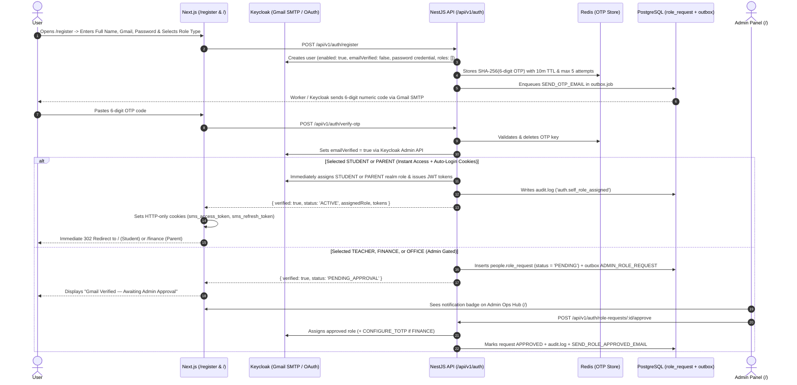

# 🔐 User Sign-Up, Gmail OTP Verification & Role Approval Specification

**Version:** 1.1  
**Identity Provider:** Keycloak (OIDC + Gmail SMTP / Google OAuth)  
**Backend API:** NestJS (`apps/api/src/modules/auth`)  
**Frontend Portal:** Next.js 15 (`apps/web/src/app/(auth)/register/page.tsx`)

---

## 1. Core Onboarding Concept

All users authenticate and verify their identity using **Gmail / Google Workspace** before gaining any system access:

1. **Self-Service Roles (`STUDENT`, `PARENT`):** Users selecting **Student** or **Parent** verify their Gmail via a generated **6-digit numeric OTP** (or Google OAuth `kc_idp_hint=google`), are **immediately assigned** their Keycloak realm role, receive HTTP-only session cookies, and are redirected straight to their portal.
2. **Admin-Gated Staff Roles (`TEACHER`, `FINANCE`, `OFFICE`):** Users selecting a staff role also verify their Gmail via the 6-digit OTP first, but are **not granted elevated privileges automatically**. Their verified request enters a `PENDING` approval queue (`people.role_request`) and triggers an **Admin Panel notification**, allowing an `ADMIN` or `PRINCIPAL` to review, optionally adjust the role, and approve them with one click.

---

## 2. End-to-End Registration & Approval Sequence



---

## 3. Keycloak Password Policy & Gmail SMTP Configuration

Passwords are managed exclusively inside Keycloak (`infra/keycloak/realm-export.json`), with secrets injected via environment variables (`.env`) so plain-text credentials are never committed to version control.

### 3.1 Keycloak Realm Settings (`infra/keycloak/realm-export.json`)

```json
{
  "realm": "college-sms",
  "enabled": true,
  "registrationAllowed": false,
  "resetPasswordAllowed": true,
  "verifyEmail": true,
  "loginWithEmailAllowed": true,
  "duplicateEmailsAllowed": false,
  "passwordPolicy": "length(8) and digits(1) and lowerCase(1) and upperCase(1) and notUsername(undefined)",
  "smtpServer": {
    "host": "${env.SMTP_HOST}",
    "port": "${env.SMTP_PORT}",
    "from": "${env.SMTP_USER}",
    "fromDisplayName": "Dhaka Model College Portal",
    "starttls": "true",
    "ssl": "false",
    "auth": "true",
    "user": "${env.SMTP_USER}",
    "password": "${env.SMTP_PASSWORD}"
  }
}
```

### 3.2 Environment Secrets (`.env`)

```env
# Keycloak Admin & Client Credentials
KEYCLOAK_ADMIN=admin
KEYCLOAK_ADMIN_PASSWORD=change_me_strong_admin_password
KEYCLOAK_WEB_CLIENT_SECRET=change_me_web_client_secret

# Gmail SMTP (16-char Google App Password)
SMTP_HOST=smtp.gmail.com
SMTP_PORT=587
SMTP_USER=your-school-noreply@gmail.com
SMTP_PASSWORD=xxxx_xxxx_xxxx_xxxx

# Cookie Security (set true in HTTPS production)
COOKIE_SECURE=false
```

---

## 4. HTTP-Only Session Cookies & Auto-Login (`apps/web`)

To keep users authenticated across Next.js App Router SSR requests and Server Actions without exposing JWTs to `localStorage` (XSS protection), login and post-OTP verification store **HTTP-only, `SameSite=Lax` cookies**:

| Cookie Name | Attributes | TTL | Purpose |
| :--- | :--- | :--- | :--- |
| **`sms_access_token`** | `HttpOnly`, `SameSite=Lax`, `Path=/`, `Secure` (prod) | 5 min (`300s`) | Short-lived Keycloak JWT verified by `JwtGuard` and injected into `apiFetch`. |
| **`sms_refresh_token`** | `HttpOnly`, `SameSite=Lax`, `Path=/`, `Secure` (prod) | 8 hrs (`28800s`) | Used by `getServerSession()` (`apps/web/src/lib/auth.ts`) to silently refresh expired access tokens without forcing re-login. |

* **Direct Login (`/login`):** Exchanges Keycloak OIDC auth code or credentials for tokens, calls `setAuthCookies()`, and redirects to `DEFAULT_LANDING_ROUTE`.
* **Post-OTP Auto-Login (`/register` $\rightarrow$ `/verify-otp`):** For `STUDENT` and `PARENT`, `verifyOtp` returns tokens alongside `{ status: 'ACTIVE' }`, setting both cookies immediately so the user lands directly on `/` or `/finance`.

---

## 5. Role Onboarding Matrix

| Selected Role | Verification Method | Post-OTP State | Keycloak Role Assignment | Default Landing Route |
| :--- | :--- | :--- | :--- | :--- |
| **`STUDENT`** | Gmail 6-digit OTP or Google OAuth | `ACTIVE` (Immediate + Cookies Set) | Auto-assigned `STUDENT` | `/` (Student Summary) |
| **`PARENT`** | Gmail 6-digit OTP or Google OAuth | `ACTIVE` (Immediate + Cookies Set) | Auto-assigned `PARENT` | `/finance` (Ward Invoices) |
| **`TEACHER`** | Gmail 6-digit OTP or Google OAuth | `PENDING_APPROVAL` | Assigned by `ADMIN` / `PRINCIPAL` | `/attendance` (Post-approval) |
| **`FINANCE`** | Gmail 6-digit OTP or Google OAuth | `PENDING_APPROVAL` | Assigned by `ADMIN` / `PRINCIPAL` + Mandatory MFA | `/finance` (Post-approval) |
| **`OFFICE`** | Gmail 6-digit OTP or Google OAuth | `PENDING_APPROVAL` | Assigned by `ADMIN` / `PRINCIPAL` | `/students` (Post-approval) |

---

## 6. Database Schema Addition (`people.role_request`)

```sql
CREATE TABLE people.role_request (
    id               uuid PRIMARY KEY DEFAULT gen_random_uuid(),
    keycloak_user_id text UNIQUE NOT NULL,
    email            text NOT NULL,
    full_name        text NOT NULL,
    requested_role   text NOT NULL CHECK (requested_role IN ('STUDENT', 'PARENT', 'TEACHER', 'FINANCE', 'OFFICE')),
    reference_no     text, -- Optional Student Admission No or Staff Employee ID
    status           text NOT NULL DEFAULT 'PENDING' CHECK (status IN ('PENDING', 'APPROVED', 'REJECTED')),
    reviewed_by      uuid,
    reviewed_at      timestamptz,
    created_at       timestamptz NOT NULL DEFAULT now()
);

CREATE INDEX idx_role_request_pending ON people.role_request (status, created_at DESC) WHERE status = 'PENDING';
```

---

## 7. API Endpoints (`apps/api/src/modules/auth/controllers/auth.controller.ts`)

| Method & Path | Auth Guard | Purpose |
| :--- | :--- | :--- |
| `POST /api/v1/auth/register` | Public (Rate-limited) | Creates unverified Keycloak account with password credential, caches hashed 6-digit OTP in Redis, enqueues Gmail OTP outbox job. |
| `POST /api/v1/auth/verify-otp` | Public (Rate-limited) | Verifies 6-digit OTP, marks `emailVerified = true` in Keycloak, auto-assigns `STUDENT`/`PARENT` + issues login tokens, or creates `PENDING` staff request. |
| `GET /api/v1/auth/role-requests` | `JwtGuard` + `@Roles('ADMIN', 'PRINCIPAL')` | Lists all pending staff role requests for the Admin notification widget. |
| `POST /api/v1/auth/role-requests/:id/approve` | `JwtGuard` + `@Roles('ADMIN', 'PRINCIPAL')` | Approves request (with optional role override), assigns Keycloak role + MFA policy, logs to `audit.log`, and notifies user via Gmail. |

---

## 8. Security Safeguards

1. **OTP Brute-Force Protection:** 6-digit codes are stored in Redis (`DB 0`) as SHA-256 hashes with a strict 10-minute TTL and a maximum of 5 verification attempts before invalidation.
2. **Zero Privilege Escalation:** Even if a user intercepts or modifies the registration payload, the API whitelist strictly rejects `ADMIN` or `PRINCIPAL` self-requests, and staff roles (`TEACHER`, `FINANCE`, `OFFICE`) never touch Keycloak role assignments until an authenticated `ADMIN` or `PRINCIPAL` approves the record.
3. **Unapproved Redirect Shield:** `getDefaultLandingRoute()` in `apps/web/src/lib/rbac.ts` routes any authenticated token with `email_verified === false` or an empty canonical role array to `/register?step=pending`.