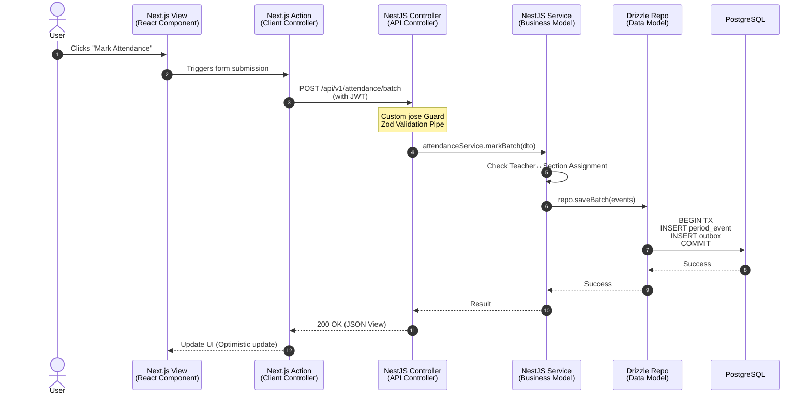

# 📁 The Total Project Layout (Modular Monorepo)

We use an Nx monorepo to separate the Backend (API/Worker), Frontend (Web), and Shared packages.

```text
sms-monorepo/
├── apps/
│   ├── api/                     # Backend (NestJS + Fastify)
│   ├── worker/                  # Background Jobs (NestJS)
│   └── web/                     # Frontend (Next.js + Tailwind + shadcn)
├── packages/
│   ├── database/                # Shared Drizzle Schema & Migrations
│   └── shared/                  # Shared Zod schemas & TypeScript types
├── infra/                       # Docker, Grafana, Sentry configs
└── nx.json                      # Module boundary enforcement rules
```

---

### 🏗️ 1. Backend Layout (`apps/api`)

Each module (e.g., Attendance, Finance) is structured using MVC. 
*   **Model:** Database schemas, Repositories, and Domain Services (business logic).
*   **Controller:** NestJS controllers that handle HTTP routing and Zod validation.
*   **View:** In a REST API, the "View" is the JSON response payload (DTOs).

```text
apps/api/src/
├── main.ts                      # Fastify bootstrap
├── app.module.ts                # Root module
├── modules/
│   ├── academic/
│   │   ├── controllers/         # HTTP entry points (AcademicController)
│   │   ├── services/            # Business Logic (Model)
│   │   ├── repositories/        # Database queries via Drizzle (Model)
│   │   ├── dtos/                # Zod schemas for Request/Response (View)
│   │   └── academic.module.ts
│   ├── attendance/
│   │   ├── controllers/         # AttendanceController (Batch, Device, Corrections)
│   │   ├── services/            # PeriodCloseService, AttendanceService
│   │   ├── repositories/        # PeriodEventRepository
│   │   ├── dtos/
│   │   └── attendance.module.ts
│   ├── finance/
│   │   ├── controllers/         # PaymentController, InvoiceController
│   │   ├── services/            # LedgerService, PaymentService
│   │   ├── repositories/        # LedgerRepository, InvoiceRepository
│   │   ├── dtos/
│   │   └── finance.module.ts
│   ├── payroll/
│   ├── people/
│   └── auth/                    # Custom jose JWT guard
└── shared/
    ├── outbox/                  # Outbox producer logic
    ├── audit/                   # Audit log producer
    └── interceptors/            # Global response formatting
```

---

### 🖥️ 2. Frontend Layout (`apps/web`)

In Next.js, the **View** is the React UI, and the **Controller** is the Next.js Server Actions or API route handlers that bridge the UI to the backend API.

```text
apps/web/src/
├── app/                         # Next.js App Router (Routing / Controllers)
│   ├── (auth)/login/
│   ├── (dashboard)/
│   │   ├── academic/            # Admin views
│   │   ├── attendance/          # Teacher views
│   │   └── finance/             # Parent / Finance views
│   └── layout.tsx
├── components/                  # Views (UI)
│   ├── ui/                      # shadcn/ui base components (buttons, dialogs)
│   ├── shared/                  # Navbars, Sidebars
│   ├── attendance/              # AttendanceRosterTable, DeviceStatus
│   └── finance/                 # PaymentForm, LedgerTable
├── actions/                     # Controllers (Server Actions calling the API)
│   ├── attendance.actions.ts
│   └── payment.actions.ts
└── lib/
    ├── api-client.ts            # Fetch wrapper with JWT injection
    └── utils.ts
```

---

### ⚙️ 3. The Worker Layout (`apps/worker`)

The worker does not have Controllers or Views. It only contains the **Model** logic to process outbox events. 

```text
apps/worker/src/
├── main.ts                      # Worker bootstrap
├── processors/                  # The Event Handlers
│   ├── pdf-generation.processor.ts
│   ├── beftn-dispatch.processor.ts
│   ├── payment-reconcile.processor.ts
│   └── notification.processor.ts
└── shared/
    └── outbox-consumer.ts       # FOR UPDATE SKIP LOCKED loop
```

---

### 📦 4. Shared Packages (`packages/`)

```text
packages/
├── database/
│   ├── schema/                  # Drizzle schemas (e.g., ledger.ts, attendance.ts)
│   ├── migrations/              # Hand-written SQL for partitions/roles
│   └── client.ts                # Drizzle DB connection pool
└── shared/
    ├── schemas/                 # Zod schemas shared between API and Web
    │   ├── payment.schema.ts
    │   └── attendance.schema.ts
    └── types/                   # Shared TypeScript interfaces
```

---

### 🔄 How the MVC Flow Works in this System

This diagram shows a request moving through the Next.js View, hitting the NestJS Controller, executing the Model (Service + Repository), and returning the View (JSON).



