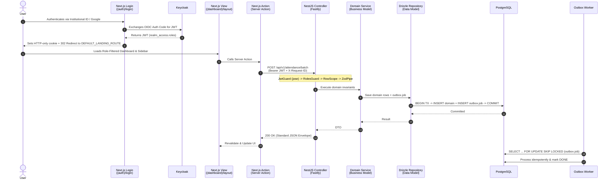

# 📁 The Total Project Layout (Modular Monorepo)

**Version:** 2.2 (Canonical Repository Specification)
**Architecture:** Nx Modular Monolith (`@nx/enforce-module-boundaries`)

```text
sms-monorepo/
├── apps/
│   ├── api/                     # Backend REST API (NestJS + Fastify)
│   ├── worker/                  # Background Outbox Worker (NestJS)
│   └── web/                     # Frontend Portal (Next.js 15 App Router + Tailwind + shadcn/ui)
├── packages/
│   ├── database/                # Shared Drizzle ORM Schemas & Hand-Written SQL Migrations
│   └── shared/                  # Shared Zod Validation Schemas & TypeScript Contracts
├── infra/                       # Docker, Postgres init, Keycloak realm, Prometheus & Grafana
├── docs/                        # Master Project Outline, Layout, Modules, Features & RBAC Matrix
├── docker-compose.yml           # Local Infrastructure Stack
├── Makefile                     # Developer & Operations Shortcuts
├── nx.json                      # Nx Workspace & Module Boundary Rules
└── tsconfig.base.json           # Root TypeScript Path Configuration
```

---

## 🏗️ 1. Backend API Layout (`apps/api`)

Each domain module follows strict MVC + Repository separation and imports cross-module types exclusively from `@sms/shared` or `@sms/database`:
* **Model:** Drizzle schemas (`packages/database`), Repositories, and Domain Services.
* **Controller:** NestJS controllers with `JwtGuard`, `RolesGuard`, and `ZodValidationPipe`.
* **View:** Standardized JSON envelopes (`ResponseInterceptor`) and RFC 7807 Problem Details (`ErrorInterceptor`).

```text
apps/api/src/
├── main.ts                                  # Fastify bootstrap & global pipes/interceptors
├── app.module.ts                            # Root module registering all 9 domain modules
├── modules/
│   ├── academic/
│   │   ├── controllers/
│   │   │   └── academic.controller.ts       # Years, terms, classes, sections, subjects, assignments
│   │   ├── dtos/
│   │   │   └── academic.dto.ts              # Zod DTO bindings
│   │   ├── repositories/
│   │   │   └── academic.repository.ts
│   │   ├── services/
│   │   │   └── academic.service.ts
│   │   └── academic.module.ts
│   ├── attendance/
│   │   ├── controllers/
│   │   │   ├── attendance.controller.ts     # Batch marking, HMAC device ingestion, corrections
│   │   │   └── period-close.controller.ts   # Monthly attendance lock & Maker-Checker approval
│   │   ├── repositories/
│   │   │   ├── attendance.repository.ts
│   │   │   └── period-close.repository.ts
│   │   ├── services/
│   │   │   ├── attendance.service.ts
│   │   │   └── period-close.service.ts
│   │   └── attendance.module.ts
│   ├── auth/
│   │   ├── controllers/
│   │   │   └── auth.controller.ts           # /auth/me, single & bulk Keycloak user provisioning
│   │   ├── services/
│   │   │   └── auth.service.ts              # Keycloak Admin REST API integration
│   │   └── auth.module.ts
│   ├── finance/
│   │   ├── controllers/
│   │   │   ├── invoice.controller.ts        # Fee schedules & bulk invoicing
│   │   │   ├── ledger.controller.ts         # Append-only ledger reads & reversals
│   │   │   └── payment.controller.ts        # Aggregator initiation & IPN webhook validation
│   │   ├── repositories/
│   │   │   ├── invoice.repository.ts
│   │   │   ├── ledger.repository.ts
│   │   │   └── payment.repository.ts
│   │   ├── services/
│   │   │   ├── invoice.service.ts
│   │   │   └── payment.service.ts
│   │   └── finance.module.ts
│   ├── leave/
│   │   ├── controllers/
│   │   │   └── leave.controller.ts          # School calendar, leave requests, approvals, substitutions
│   │   ├── repositories/
│   │   │   └── leave.repository.ts
│   │   ├── services/
│   │   │   └── leave.service.ts
│   │   └── leave.module.ts
│   ├── notice/
│   │   ├── controllers/
│   │   │   └── notice.controller.ts         # Notice CRUD, role targeting & publish trigger
│   │   ├── repositories/
│   │   │   └── notice.repository.ts
│   │   ├── services/
│   │   │   └── notice.service.ts
│   │   └── notice.module.ts
│   ├── payroll/
│   │   ├── controllers/
│   │   │   └── payroll.controller.ts        # Payroll runs, Maker-Checker approval, failed-line retry
│   │   ├── repositories/
│   │   │   └── payroll.repository.ts
│   │   ├── services/
│   │   │   └── payroll.service.ts
│   │   └── payroll.module.ts
│   ├── people/
│   │   ├── controllers/
│   │   │   ├── staff.controller.ts          # Staff directory CRUD
│   │   │   └── student.controller.ts        # Student directory, bulk CSV import & enrollments
│   │   ├── repositories/
│   │   │   ├── staff.repository.ts
│   │   │   └── student.repository.ts
│   │   ├── services/
│   │   │   ├── staff.service.ts
│   │   │   └── student.service.ts
│   │   └── people.module.ts
│   └── search/
│       ├── controllers/
│       │   └── search.controller.ts         # ID-only Postgres FTS + pg_trgm search endpoints
│       ├── repositories/
│       │   └── search.repository.ts
│       ├── services/
│       │   └── search.service.ts
│       └── search.module.ts
└── shared/
    ├── audit/                               # Append-only audit.log writer
    ├── database/                            # Drizzle client provider & module
    ├── decorators/                          # @CurrentUser(), @Roles()
    ├── guards/                              # JwtGuard (jose JWKS), RolesGuard
    ├── interceptors/                        # ErrorInterceptor (RFC 7807), ResponseInterceptor
    ├── middleware/                          # RequestIdMiddleware & RowScope attachment
    ├── outbox/                              # Transactional outbox.job producer
    ├── pipes/                               # ZodValidationPipe
    ├── redis/                               # Redis cache & rate-limit provider
    ├── s3/                                  # Cloudflare R2 S3-compatible presigned URL service
    └── shared.module.ts
```

---

## 🖥️ 2. Frontend Layout (`apps/web`)

```text
apps/web/src/
├── app/
│   ├── (auth)/
│   │   └── login/
│   │       └── page.tsx                     # Keycloak OIDC / Google Workspace login & 302 role redirect
│   ├── (dashboard)/
│   │   ├── academic/
│   │   │   └── page.tsx                     # Academic years, terms, classes, sections, subjects
│   │   ├── attendance/
│   │   │   ├── page.tsx                     # Teacher roster marking & correction requests
│   │   │   └── period-close/
│   │   │       └── page.tsx                 # HR monthly close preview & Maker-Checker lock
│   │   ├── finance/
│   │   │   └── page.tsx                     # Fee schedules, invoices, MFS payments & ledger
│   │   ├── leave/
│   │   │   └── page.tsx                     # Staff leave requests, approvals & holiday calendar
│   │   ├── notices/
│   │   │   └── page.tsx                     # Role-targeted notice board & publishing
│   │   ├── payroll/
│   │   │   └── page.tsx                     # Payroll runs, approvals, BEFTN & failed payouts
│   │   ├── staff/
│   │   │   └── page.tsx                     # Staff directory & Keycloak provisioning
│   │   ├── students/
│   │   │   └── page.tsx                     # Student directory, CSV import & enrollment
│   │   ├── layout.tsx                       # Auth shield + canAccessPath guard + Sidebar/Navbar shell
│   │   └── page.tsx                         # Role-aware dashboard home
│   ├── globals.css
│   └── layout.tsx
├── actions/                                 # Next.js Server Actions (Client Controllers)
│   ├── attendance.actions.ts
│   └── payment.actions.ts
├── components/
│   ├── shared/
│   │   ├── navbar.tsx
│   │   └── sidebar.tsx                      # Role-filtered navigation sidebar
│   └── ui/                                  # shadcn/ui primitives (badge, button, card, etc.)
└── lib/
    ├── api-client.ts                        # Typed fetch wrapper injecting Bearer JWT & Request-ID
    ├── auth.ts                              # HTTP-only cookie session & Keycloak JWT decoder
    ├── rbac.ts                              # Role landing map, sidebar filter & route access guard
    └── utils.ts
```

---

## ⚙️ 3. Background Worker Layout (`apps/worker`)

```text
apps/worker/src/
├── main.ts                                  # Worker bootstrap
├── worker.module.ts                         # Registers OutboxConsumer & all 5 processors
├── processors/
│   ├── beftn-dispatch.processor.ts          # Generates bulk BEFTN bank payout file -> R2
│   ├── notification.processor.ts            # Deduped SMS/Email/In-App dispatcher
│   ├── payment-reconcile.processor.ts       # 5-min stale payment poller & 02:00 daily recon
│   ├── payroll-compute.processor.ts         # Computes payroll strictly from APPROVED period_close
│   └── pdf-generation.processor.ts          # Generates fee receipts & payslip PDFs -> R2
└── shared/
    ├── logger.ts                            # Pino structured worker logger
    └── outbox-consumer.ts                   # FOR UPDATE SKIP LOCKED claim loop + stuck reclaimer
```

---

## 📦 4. Shared Packages & Infrastructure (`packages/` & `infra/`)

```text
packages/
├── database/
│   ├── drizzle.config.ts
│   └── src/
│       ├── client.ts                        # PostgreSQL connection pool
│       ├── index.ts
│       ├── migrations/                      # Hand-written SQL DDL, partitions, roles & triggers
│       └── schema/                          # Drizzle table definitions
│           ├── academic.ts
│           ├── attendance.ts
│           ├── audit.ts
│           ├── finance.ts
│           ├── leave.ts
│           ├── notice.ts
│           ├── outbox.ts
│           ├── payroll.ts
│           └── people.ts
└── shared/
    └── src/
        ├── index.ts
        ├── schemas/                         # Shared Zod schemas (API + Web)
        │   ├── academic.schema.ts
        │   ├── attendance.schema.ts
        │   ├── common.schema.ts
        │   ├── leave.schema.ts
        │   ├── notice.schema.ts
        │   ├── payment.schema.ts
        │   ├── payroll.schema.ts
        │   └── people.schema.ts
        └── types/
            ├── events.ts                    # Outbox event payload contracts
            ├── index.ts
            └── roles.ts                     # 7 canonical Keycloak RBAC roles

infra/
├── docker/postgres/init.sql                 # Extensions, schemas & restricted DB roles
├── grafana/provisioning/dashboards/         # Outbox, API, Postgres & Keycloak dashboards
├── keycloak/realm-export.json               # Pre-configured realm, 7 roles & Google OAuth broker
└── prometheus/prometheus.yml                # Metrics scrape configuration
```

---

## 🔄 5. End-to-End Authentication, Request & Outbox Flow

