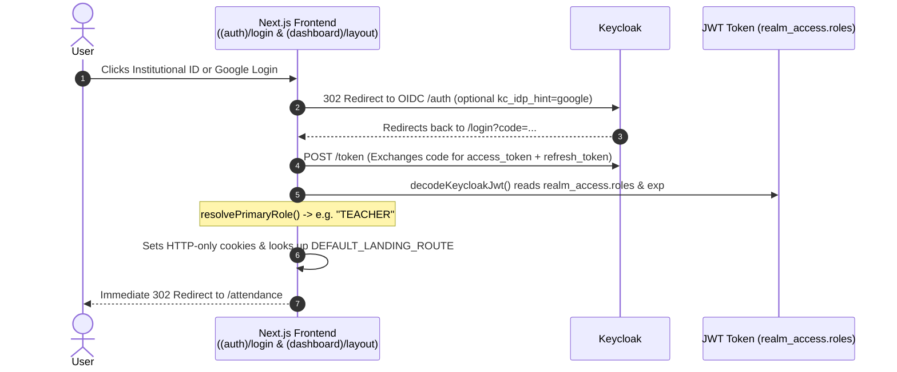

# 🛡️ RBAC & Role-Based Frontend Specification

**Version:** 1.1  
**Identity Provider:** Keycloak (OIDC / JWT)  
**Frontend Framework:** Next.js 15 App Router (`apps/web`)  
**Canonical Roles (7):** `ADMIN`, `PRINCIPAL`, `TEACHER`, `OFFICE`, `FINANCE`, `STUDENT`, `PARENT`

---

## 1. Role Hierarchy & Default Landing Map

Upon Keycloak OIDC callback (`/login?code=...`), `apps/web/src/app/(auth)/login/page.tsx` exchanges the authorization code for an access token, decodes `realm_access.roles` via `decodeKeycloakJwt()`, resolves the highest-priority role (`resolvePrimaryRole`), sets HTTP-only cookies (`sms_access_token`, `sms_refresh_token`), and issues an immediate `302` redirect to `DEFAULT_LANDING_ROUTE`:

| Priority | Keycloak Role | Default Landing Route | Immediate View | Data Scope (`RowScope`) | MFA Policy |
| :---: | :--- | :--- | :--- | :--- | :--- |
| **1** | **`ADMIN`** | `/` | System Ops Hub (Outbox, Keycloak health) | `unrestricted: true` | **Mandatory** |
| **2** | **`PRINCIPAL`** | `/` | Executive KPI Dashboard & Approvals | `unrestricted: true` | **Mandatory** |
| **3** | **`FINANCE`** | `/finance` | Today's MFS Settlements & Overdue Invoices | `unrestricted: true` | **Mandatory** |
| **4** | **`OFFICE`** | `/students` | Enrollment Queue & Bulk CSV Import | `unrestricted: true` | Optional |
| **5** | **`TEACHER`** | `/attendance` | Today's Roster & Classes | `sectionIds: [...]` | Optional |
| **6** | **`PARENT`** | `/finance` | Child's Unpaid Invoices & "Pay Now" button | `studentIds: [children...]` | Disabled |
| **7** | **`STUDENT`** | `/` | Own Attendance % & Notices | `studentIds: [self]` | Disabled |

---

## 2. Authentication & Redirect Sequence

---

## 3. Frontend Route & Navigation Matrix (`apps/web/src/app/(dashboard)`)

All authenticated routes pass through `apps/web/src/app/(dashboard)/layout.tsx`, which calls `getServerSession()` and `canAccessPath(session.roles, currentPath)`. Any unauthorized direct URL request is immediately redirected back to `getDefaultLandingRoute(session.roles)`.

| Route | `ADMIN` | `PRINCIPAL` | `OFFICE` | `FINANCE` | `TEACHER` | `STUDENT` | `PARENT` |
| :--- | :---: | :---: | :---: | :---: | :---: | :---: | :---: |
| **`/`** (Role Home) | Ops Hub | Exec KPI | Desk Queue | Finance KPI | My Classes | My Summary | Ward Summary |
| **`/academic`** | Full CRUD | View / Approve | Full CRUD | Read-Only | My Sections | My Timetable | Ward Timetable |
| **`/students`** | Full CRUD + CSV | View All | Full CRUD + CSV | Fee View Only | Assigned Sections | Own Profile | Linked Wards |
| **`/staff`** | Full CRUD + Provision | View All | Full CRUD | Payroll Profile | Own Profile | ❌ Blocked | ❌ Blocked |
| **`/attendance`** | Override + Audit | Approve Corrections | View / Export | Read-Only | Mark Roster + Request Fix | Own History | Ward History |
| **`/attendance/period-close`** | Audit View | Final Lock (`LOCKED`) | Draft Close (`SUBMIT`) | Read Snapshot | ❌ Blocked | ❌ Blocked | ❌ Blocked |
| **`/leave`** | Full Admin | Final Approve | HR Queue + Calendar | Leave Deductions | Submit Request + Balance | ❌ Blocked | ❌ Blocked |
| **`/finance`** | Audit View | Waiver Approve | Fee View | Full Ledger + Waivers | ❌ Blocked | View Invoices | Pay Fees (MFS) + Receipts |
| **`/payroll`** | Audit View | Approve Run | View Status | Create / Dispatch BEFTN | Own Payslips | ❌ Blocked | ❌ Blocked |
| **`/notices`** | Publish All | Publish All | Publish Audience | Publish Fee Notice | Read / Class Notice | Read Targeted | Read Targeted |

---

## 4. Defense-in-Depth Enforcement Layers

1. **Keycloak Token Claims (`infra/keycloak/realm-export.json`):** Issues 5-minute JWTs containing `realm_access.roles` and enforces MFA for `ADMIN`, `PRINCIPAL`, and `FINANCE`.
2. **Next.js Login Callback & Layout Guard (`apps/web/src/lib/rbac.ts`):**
   * `DEFAULT_LANDING_ROUTE` & `resolvePrimaryRole()` eliminate post-login navigation friction.
   * `getAllowedNavItems()` hides unauthorized links in `components/shared/sidebar.tsx`.
   * `canAccessPath()` blocks direct URL entry in `(dashboard)/layout.tsx`.
3. **NestJS API Guards & `RowScope` (`apps/api`):**
   * `JwtGuard` (`jose` JWKS) + `@Roles()` `RolesGuard` reject unauthorized API calls (`403 Forbidden`).
   * `RowScope` scopes queries strictly to `sectionIds` (`TEACHER`) or `studentIds` (`STUDENT`/`PARENT`).