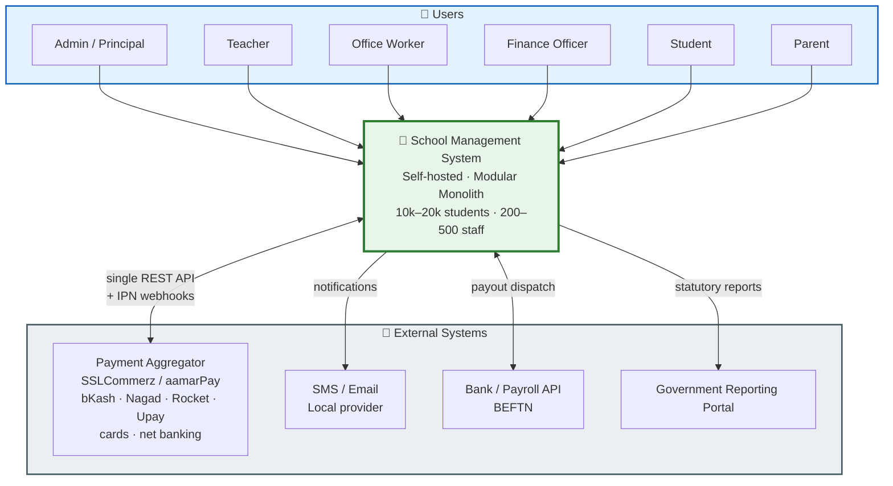
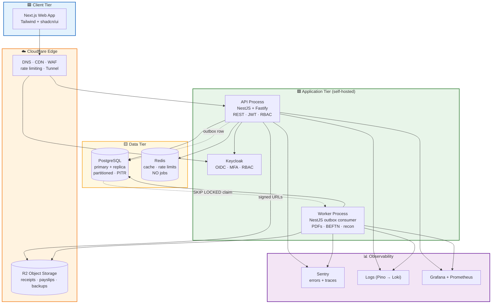
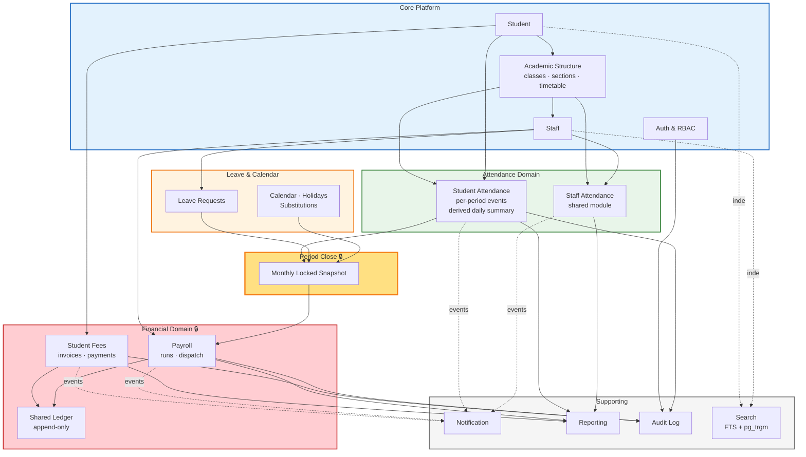
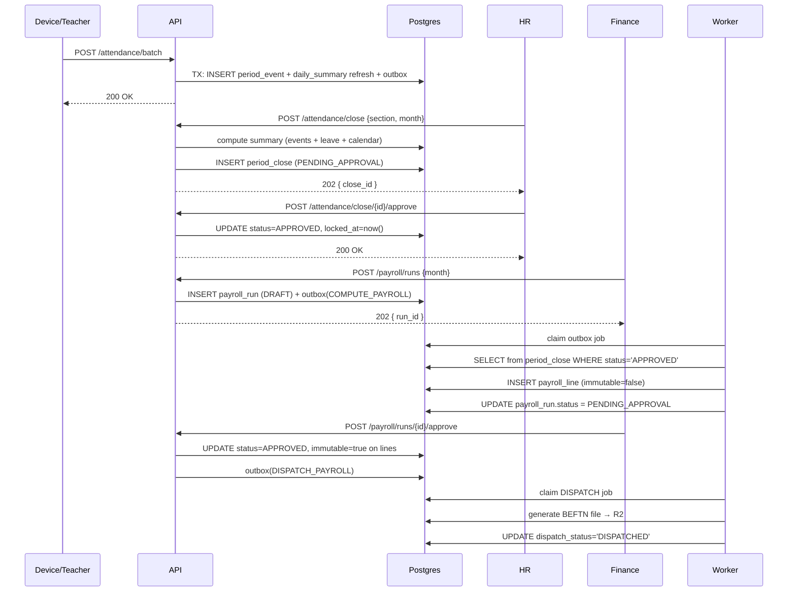
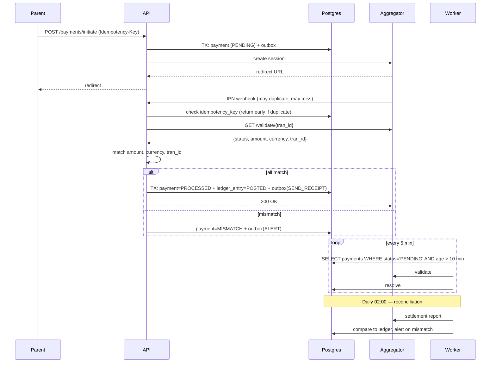

# 🏫 School Management System — Complete Project Outline

**Version:** 1.0 (Master Project Document)
**Status:** Ready for Execution
**Last Updated:** 2026-11-19
**Owner:** Lead Architect / Project Lead

---

## 📑 Table of Contents

1. [Project Overview](#1-project-overview)
2. [Architectural Invariants](#2-architectural-invariants)
3. [System Architecture](#3-system-architecture)
4. [Technology Stack](#4-technology-stack)
5. [Database Design](#5-database-design)
6. [Critical Business Flows](#6-critical-business-flows)
7. [API Contracts](#7-api-contracts)
8. [Identity & Security](#8-identity--security)
9. [Payment Integration](#9-payment-integration)
10. [Operations & Deployment](#10-operations--deployment)
11. [Observability](#11-observability)
12. [Testing Strategy](#12-testing-strategy)
13. [Repository Structure](_________)
14. [Roadmap & Phases](#14-roadmap--phases)
15. [Detailed Task Breakdown](#15-detailed-task-breakdown)
16. [Open Decisions](#16-open-decisions)
17. [Risk Register](#17-risk-register)
18. [Definition of Done](#18-definition-of-done)
19. [Appendices](#19-appendices)

---

## 1. Project Overview

### 1.1 What We Are Building

An **enterprise-grade school management system** for a single institution in Bangladesh, handling:

- **Student attendance** (daily or per-period)
- **Staff attendance** (teachers + office workers)
- **Student fee payments** (via bKash, Nagad, Rocket, Upay, cards, net banking)
- **Payroll** (teachers + office staff, with BEFTN/bank dispatch)
- **Academic structure** (classes, sections, timetable, subjects)
- **Leave management** (requests, approvals, calendar, substitutions)
- **Notices & notifications** (free-text search, SMS, email, in-app)
- **Reporting** (attendance, finance, payroll, statutory compliance)

### 1.2 Scale

| Dimension | Value |
| :--- | :--- |
| Students | 10,000 – 20,000 |
| Staff | 200 – 500 |
| Attendance rows/year | ~4M (daily) to ~24M (per-period) |
| Payment volume | ~40,000 – 60,000/year |
| Payroll lines/month | ~200 – 500 |
| Peak concurrent users | 300 – 800 |
| Peak requests/sec | 50 – 150 |

### 1.3 Deployment Model

- **Self-hosted** in the institution's data center
- **Cloudflare** as edge (CDN, WAF, DNS, optional tunnel)
- **Object storage** = Cloudflare R2 (S3-compatible)
- **Backups** off-site in a separate credential domain

### 1.4 Out of Scope

- Multi-tenant SaaS (single institution only)
- Microservices
- Event sourcing
- Message brokers (Kafka, RabbitMQ, NATS)
- Mobile native apps (API-ready, web-first)
- Learning management system features

---

## 2. Architectural Invariants

These are **non-negotiable**. Any change requires a new ADR and explicit approval.

| # | Invariant | Consequence |
| :--- | :--- | :--- |
| **1** | **PostgreSQL is the single source of truth.** | Everything else is cache, copy, or derived view. |
| **2** | **Redis dying makes the system slower, never incorrect.** | No server-side sessions. Stateless JWT. No jobs in Redis. |
| **3** | **No dual writes.** Business row + outbox row commit in one Postgres transaction. | No Kafka, no broker, no dual-write race. |
| **4** | **Search returns IDs; Postgres returns rows.** | Permissions, money, PII never come from an index. |
| **5** | **Upgrades are triggered by a measured problem.** | Every "add X later" has a written trigger. |
| **6** | **All artifact storage is S3-API-compatible behind signed URLs.** | Provider swappable. Files never touch the API process. |
| **7** | **Every handler is idempotent. Every outbox row is reclaimable.** | At-least-once delivery is the contract. |
| **8** | **Financial operations are append-only.** | Never `UPDATE` or `DELETE` a money row. Corrections are offsetting entries. |
| **9** | **Payroll reads only approved, locked attendance summaries.** | A late correction cannot change a paid salary. |
| **10** | **Audit log is append-only and covers attendance.** | The DB role cannot UPDATE or DELETE audit rows. |

---

## 3. System Architecture

### 3.1 C4 Level 1 — System Context



### 3.2 C4 Level 2 — Container Diagram



### 3.3 Module Map (Bounded Contexts)



---

## 4. Technology Stack

### 4.1 Stack Summary

| Layer | Choice | Rationale |
| :--- | :--- | :--- |
| **Frontend** | Next.js 15 (App Router) + Tailwind CSS + shadcn/ui | Server components, streaming, accessible components |
| **API Framework** | NestJS on Fastify adapter | Module boundaries, DI, performance |
| **Database** | PostgreSQL 16+ (primary + replica) | ACID, partitioning, RLS, PITR |
| **ORM / Queries** | Drizzle ORM (query builder) + hand-written SQL for DDL | SQL visibility for ledger, partitioning |
| **Validation** | Zod (via `nestjs-zod`) | One schema → runtime, types, OpenAPI |
| **Search** | Postgres FTS + `pg_trgm` (default) → Meilisearch (spike-gated) | No extra infra at launch |
| **Object Storage** | Cloudflare R2 (S3-compatible) | Zero egress, presigned URLs |
| **CDN / Edge** | Cloudflare (DNS, CDN, WAF, Tunnel) | Split-horizon for LAN continuity |
| **Payments** | Single aggregator (SSLCommerz / aamarPay) | All MFS + cards via one integration |
| **Identity** | Keycloak + custom `jose` guard | Stateless JWT, no heavy adapter |
| **Background Jobs** | Postgres `outbox.job` (`FOR UPDATE SKIP LOCKED`) | No BullMQ, no Redis for jobs |
| **Observability** | Sentry + Pino + Grafana/Prometheus | Errors, logs, metrics |
| **Testing** | Vitest + `unplugin-swc` + Testcontainers | Fast unit; real Postgres integration |
| **Monorepo** | Nx with `@nx/enforce-module-boundaries` | Module isolation at build time |
| **Automation** | TypeScript only | Financial domain stays in one language |
| **Package Manager** | pnpm | Fast, disk-efficient |

### 4.2 Key Package Versions

```jsonc
// apps/api/package.json (excerpt)
{
  "dependencies": {
    "@nestjs/common": "^11.0.0",
    "@nestjs/core": "^11.0.0",
    "@nestjs/platform-fastify": "^11.0.0",
    "@nestjs/swagger": "^8.0.0",
    "drizzle-orm": "^0.38.0",
    "zod": "^3.24.0",
    "nestjs-zod": "^4.0.0",
    "jose": "^5.9.0",
    "pino": "^9.5.0",
    "pino-http": "^10.3.0",
    "@sentry/node": "^8.40.0",
    "@sentry/profiling-node": "^8.40.0",
    "pg": "^8.13.0",
    "@aws-sdk/client-s3": "^3.700.0",
    "@aws-sdk/s3-request-presigner": "^3.700.0"
  },
  "devDependencies": {
    "drizzle-kit": "^0.30.0",
    "vitest": "^2.1.0",
    "testcontainers": "^10.16.0",
    "unplugin-swc": "^1.5.0",
    "typescript": "^5.7.0"
  }
}
```

```jsonc
// apps/web/package.json (excerpt)
{
  "dependencies": {
    "next": "^15.0.0",
    "react": "^19.0.0",
    "react-dom": "^19.0.0",
    "@tanstack/react-query": "^5.60.0",
    "zod": "^3.24.0",
    "tailwindcss": "^3.4.0",
    "@sentry/nextjs": "^8.40.0"
  }
}
```

### 4.3 Critical Configuration Notes

| Concern | Configuration |
| :--- | :--- |
| **Vitest + NestJS** | `unplugin-swc` with `decoratorMetadata: true`, `legacyDecorator: true` |
| **Drizzle** | Disable auto-diffs; use hand-written SQL for partitions, roles, triggers |
| **Redis** | Two logical databases: `REDIS_DB_CACHE=0`, `REDIS_DB_RATELIMIT=1` |
| **Keycloak** | Custom guard using `jose`; JWKS cached 1 hour |
| **Sentry** | Separate DSNs for dev and prod |

---

## 5. Database Design

### 5.1 Schema Overview

```text
academic   — academic_year, term, class, section, subject, teacher_section
people     — student, staff, enrollment
attendance — period_event (partitioned), daily_summary (matview),
             correction_request, period_close
leave      — calendar_day, leave_type, leave_request, substitution
finance    — ledger_entry (append-only), invoice, payment,
             fee_schedule, adjustment, reconciliation_run
payroll    — payroll_run, payroll_line, dispatch_batch, payslip
notice     — notice (with tsvector search_vector)
outbox     — job (the single job queue)
audit      — log (append-only)
```

### 5.2 Key Tables

**Attendance (source of truth — partitioned):**

```sql
CREATE TABLE attendance.period_event (
    student_id   uuid NOT NULL,
    event_date   date NOT NULL,
    period       smallint NOT NULL,       -- 0 = daily-only
    section_id   uuid NOT NULL,
    subject_id   uuid,
    status       text NOT NULL CHECK (status IN ('PRESENT','ABSENT','LATE','EXCUSED')),
    source       text NOT NULL CHECK (source IN ('DEVICE','MANUAL','IMPORT','CORRECTION')),
    marked_by    uuid NOT NULL,
    marked_at    timestamptz NOT NULL DEFAULT now(),
    device_id    uuid,
    note         text,
    PRIMARY KEY (student_id, event_date, period)
) PARTITION BY RANGE (event_date);
-- Monthly partitions created 60 days ahead by scheduler
```

**Ledger (append-only — the ONLY place money lives):**

```sql
CREATE TABLE finance.ledger_entry (
    id              uuid PRIMARY KEY,
    account         text NOT NULL CHECK (account IN ('STUDENT_FEES','PAYROLL','WAIVER','REFUND','ADJUSTMENT')),
    party_type      text NOT NULL CHECK (party_type IN ('STUDENT','STAFF')),
    party_id        uuid NOT NULL,
    amount          numeric(12,2) NOT NULL,
    currency        char(3) NOT NULL DEFAULT 'BDT',
    direction       text NOT NULL CHECK (direction IN ('DEBIT','CREDIT')),
    source          text NOT NULL,
    source_id       uuid NOT NULL,
    reversal_of     uuid REFERENCES finance.ledger_entry(id),
    idempotency_key text UNIQUE NOT NULL,
    posted_at       timestamptz NOT NULL DEFAULT now(),
    posted_by       uuid NOT NULL,
    status          text NOT NULL DEFAULT 'POSTED' CHECK (status IN ('POSTED','REVERSED'))
);
-- NEVER UPDATE OR DELETE. Corrections = new rows with reversal_of set.
```

**Period Close (the gate between attendance and payroll):**

```sql
CREATE TABLE attendance.period_close (
    id             uuid PRIMARY KEY,
    section_id     uuid NOT NULL,
    month          date NOT NULL,
    status         text NOT NULL DEFAULT 'DRAFT'
                   CHECK (status IN ('DRAFT','PENDING_APPROVAL','APPROVED','LOCKED')),
    summary        jsonb NOT NULL,        -- frozen snapshot
    submitted_by   uuid,
    submitted_at   timestamptz,
    approved_by    uuid,
    approved_at    timestamptz,
    locked_at      timestamptz,
    UNIQUE (section_id, month),
    CONSTRAINT maker_neq_checker CHECK (approved_by IS NULL OR approved_by <> submitted_by)
);
```

**Outbox (the single job queue):**

```sql
CREATE TABLE outbox.job (
    id                uuid PRIMARY KEY,
    type              text NOT NULL,
    payload           jsonb NOT NULL,
    dedupe_key        text UNIQUE NOT NULL,
    status            text NOT NULL DEFAULT 'PENDING'
                      CHECK (status IN ('PENDING','CLAIMED','DONE','DEAD')),
    attempts          int NOT NULL DEFAULT 0,
    max_attempts      int NOT NULL DEFAULT 5,
    next_attempt_at   timestamptz NOT NULL DEFAULT now(),
    locked_at         timestamptz,
    locked_by         text,
    last_error        text,
    run_at            timestamptz NOT NULL DEFAULT now(),
    created_at        timestamptz NOT NULL DEFAULT now(),
    completed_at      timestamptz
);
CREATE INDEX ON outbox.job (status, next_attempt_at) WHERE status IN ('PENDING','CLAIMED');
```

### 5.3 Database Roles (Enforcement Layer)

```sql
CREATE ROLE sms_api LOGIN;
CREATE ROLE sms_worker LOGIN;
CREATE ROLE sms_payroll_reader LOGIN;   -- can ONLY read period_close, NOT period_event

GRANT INSERT, SELECT ON finance.ledger_entry TO sms_api;    -- NO UPDATE, NO DELETE
GRANT INSERT ON audit.log TO sms_api;                        -- NO UPDATE, NO DELETE
-- Payroll worker physically cannot read attendance.period_event
```

---

## 6. Critical Business Flows

### 6.1 Attendance → Period Close → Payroll



**The gate:** payroll reads only `period_close` with `status='APPROVED'`. Corrections after close create adjustment rows in the next period. A late edit cannot change a paid salary.

### 6.2 Payment Flow



### 6.3 Leave → Period Close

Leave requests are **inputs to period close**, not direct payroll mutations. An approved leave day is subtracted from absence before deduction calculation.

---

## 7. API Contracts

### 7.1 Conventions

| Convention | Value |
| :--- | :--- |
| Base path | `/api/v1` |
| Auth | `Authorization: Bearer <jwt>` |
| Content type | `application/json` |
| IDs | UUID strings |
| Timestamps | ISO 8601 UTC |
| Pagination | `?limit=50&cursor=<opaque>` |
| Idempotency | `Idempotency-Key` header on state/money-creating POSTs |
| Errors | RFC 7807 Problem Details |
| Versioning | URL prefix only |

### 7.2 Endpoint Summary

| Module | Key Endpoints |
| :--- | :--- |
| **Auth** | `POST /auth/logout`, `GET /me` |
| **Academic** | `GET/POST /academic/years`, `/terms`, `/sections`, `POST /academic/teacher-assignments` |
| **Students** | `GET/POST /students`, `GET /students/{id}`, `POST /students/import` |
| **Staff** | `GET/POST /staff` |
| **Attendance** | `POST /attendance/batch`, `POST /attendance/device`, `GET /attendance/students/{id}`, `POST /attendance/corrections`, `POST /attendance/close`, `POST /attendance/close/{id}/approve` |
| **Leave** | `POST /leave`, `POST /leave/{id}/approve`, `GET /leave/calendar` |
| **Finance** | `POST /finance/invoices/bulk`, `POST /finance/payments/initiate`, `POST /finance/payments/ipn`, `POST /finance/waivers`, `GET /finance/ledger` |
| **Payroll** | `POST /payroll/runs`, `POST /payroll/runs/{id}/approve`, `POST /payroll/runs/{id}/dispatch`, `POST /payroll/failed-lines/{id}/retry` |
| **Notices** | `GET/POST /notices`, `POST /notices/{id}/publish` |
| **Search** | `GET /search/students`, `/search/staff`, `/search/notices` |

### 7.3 Error Format

```json
{
  "type": "https://sms.school.edu.bd/errors/validation-failed",
  "title": "Validation failed",
  "status": 422,
  "detail": "One or more fields are invalid.",
  "instance": "/api/v1/finance/payments/initiate",
  "request_id": "req_a1b2c3",
  "errors": [{ "field": "amount", "code": "greater_than_zero", "message": "..." }]
}
```

---

## 8. Identity & Security

### 8.1 Keycloak Setup

| Concern | Decision |
| :--- | :--- |
| **Deployment** | Self-hosted, dedicated PostgreSQL database |
| **Roles** | `ADMIN, PRINCIPAL, TEACHER, OFFICE, FINANCE, STUDENT, PARENT` |
| **MFA** | Mandatory: ADMIN, PRINCIPAL, FINANCE. Optional: TEACHER, OFFICE. Not: students |
| **Token TTL** | Access 5 min; refresh 8 hours |
| **Validation** | Custom `jose` guard, JWKS cached 1 hour |
| **Admin console** | LAN only — never through public tunnel |
| **HA** | Two instances behind local LB, or documented accept-risk |

### 8.2 Authorization Layers

1. **Keycloak** — "May this role call this endpoint?"
2. **API middleware** — Row scope (teacher can only see own sections)
3. **Module code** — Domain invariants (invoice state machine, ledger rules)
4. **Postgres grants** — Payroll role physically cannot read raw attendance

### 8.3 Split-Horizon DNS

| User location | DNS resolves to |
| :--- | :--- |
| Campus LAN | `sms.school.local` → LAN IP (works without internet) |
| Remote | `sms.school.edu.bd` → Cloudflare → Tunnel → origin |

---

## 9. Payment Integration

### 9.1 Aggregator

**Single REST API** to SSLCommerz or aamarPay, covering:
- MFS: bKash, Nagad, Rocket, Upay
- Cards: Visa, Mastercard, Amex, DBBL Nexus
- Internet banking
- Cash (recorded manually by finance officer, same ledger)

### 9.2 Rules

- `Idempotency-Key` mandatory
- Verify IPN signature **+ call aggregator validation API**
- Match **amount, currency, tran_id**
- Ledger entry posts **in the same transaction** as status update
- Duplicate IPNs return 200 immediately
- Poller every 5 min for missed webhooks
- **Daily reconciliation** vs settlement report

---

## 10. Operations & Deployment

### 10.1 Infrastructure

| Component | Spec | Rationale |
| :--- | :--- | :--- |
| **API** | 2 instances × (4 vCPU / 8 GB) | HA, not throughput |
| **Worker** | 1 instance × (2 vCPU / 4 GB) | Scale horizontally on backlog |
| **Keycloak** | 2 instances × (2 vCPU / 4 GB) or documented single | Auth HA |
| **PostgreSQL** | 8 vCPU / 32 GB SSD + replica (decision pending) | Source of truth |
| **Redis** | 2 GB | Cache + rate limits only |
| **Object storage** | Cloudflare R2 | Zero egress |
| **Edge** | Cloudflare | WAF, DDoS, Tunnel |

### 10.2 Power & Connectivity (Self-Hosted Essentials)

- **UPS:** ≥30 min runtime at full load
- **Generator:** Auto-transfer switch, monthly test
- **Second ISP:** Different physical path, auto-failover
- **Environment monitoring:** Temperature + humidity alerts

### 10.3 Backup & DR

| Requirement | Target |
| :--- | :--- |
| RPO | ≤ 15 minutes (WAL archiving) |
| RTO | ≤ 4 hours |
| Restore drills | **Quarterly** — restore into isolated env, verify, log |
| Backup location | **Outside data center, separate credential domain** |
| Object versioning | Enabled |

### 10.4 Attendance Device Integration

- Each device has a **unique HMAC key**, provisioned out of band
- Device endpoint is **VLAN-scoped** — not exposed via tunnel
- Manual clock-in through teacher UI is allowed but creates an entry flagged `manual` that requires **manager approval** to count in payroll

---

## 11. Observability

### 11.1 Sentry (Errors + Traces)

| Component | Setup |
| :--- | :--- |
| **NestJS API** | `@sentry/node` + `@sentry/profiling-node` |
| **Next.js** | `@sentry/nextjs` via wizard |
| **DSNs** | Separate for dev and prod |
| **Sampling** | Adjust for production volume |

### 11.2 Pino (Structured Logs)

Every request logs `request_id`, `actor_id`, `route`, `status`, `duration_ms`. Logs flow to Loki.

### 11.3 Grafana Dashboards (Before Feature Work)

| Dashboard | Key Panels |
| :--- | :--- |
| **Outbox** | Pending, dead, stuck rows, oldest pending age |
| **API** | p95 latency, error rate, request rate |
| **Postgres** | Connections, replication lag, disk |
| **Keycloak** | Login failure rate |
| **Sentry** | Error rate, unresolved issues |

### 11.4 Alerts (🔒)

- Outbox pending > 100 for 5 min
- Outbox dead count > 0
- Stuck rows older than visibility timeout
- API p95 > 500ms for 5 min
- Payment reconciliation mismatch

---

## 12. Testing Strategy

| Test type | Tool | Scope |
| :--- | :--- | :--- |
| **Unit** | Vitest | Domain logic, use cases |
| **Integration** | Vitest + Testcontainers | API endpoints, Drizzle, outbox |
| **Contract** | Zod + OpenAPI validator | Request/response schemas |
| **E2E** | Playwright | Login → attendance → invoice |
| **Architecture** | `@nx/enforce-module-boundaries` | No cross-module internal imports |
| **Migration** | Hand-written SQL + CI test | Forward → backward → forward |

**Mandatory config:** `unplugin-swc` with `decoratorMetadata: true` for NestJS DI in Vitest.

---


**The `contract/` folder in each module** is the only thing other modules may import. `@nx/enforce-module-boundaries` fails the build on any violation.

---

## 14. Roadmap & Phases

| Phase | Weeks | Contents | Exit criteria |
| :--- | :--- | :--- | :--- |
| **P0 · De-risk** | 1–2 | 10 ADRs filed (bank, aggregator, HA, Bangla spike, SMS, hosting) | All ADRs exist |
| **P1 · Foundation** | 2–3 | Repo, CI, docker-compose, Keycloak realm, JWT guard, observability, **walking skeleton** | Skeleton passes all acceptance criteria |
| **Slice 1 · Auth + Academic** | 3–6 | Academic structure, teacher assignments, RBAC, audit | Admin can create year→term→class→section |
| **Slice 2 · People + Search** | 6–8 | Student/staff CRUD, bulk import, FTS search | 20k students import in <5 min |
| **Slice 3 · Attendance** | 8–12 | Period events, device ingestion, corrections, batch API | 500 concurrent teachers, p95 <500ms |
| **Slice 4 · Leave** | 12–14 | Leave requests, approvals, calendar, substitutions | Maker-checker tested |
| **Slice 5 · Period Close** | 14–16 | Close gate, summary computation, adjustment flow | Payroll role cannot read raw attendance |
| **Slice 6 · Money In** | 16–20 | Ledger, invoicing, aggregator integration, reconciliation | Restore drill #1 + pen test |
| **Slice 7 · Money Out** | 20–24 | Payroll run, maker-checker, BEFTN dispatch, failed-line queue | Parallel payroll matches old system |
| **Slice 8 · Notices** | 24–26 | Notices CRUD, publish, notifications | |
| **P6 · Migration + Go-Live** | 26–34 | Data migration, training, UAT, cutover, hypercare | Live system |

**Realistic timelines by team size:**
- 1 developer: 12–18 months
- 2 developers + 0.5 ops: 8–10 months
- 3 developers + 1 ops + 0.5 QA: 6–8 months

---

## 15. Detailed Task Breakdown

### Phase 0 — De-risk (Weeks 1–2)

| ID | Task | Done when |
| :--- | :--- | :--- |
| P0-01 | ADR template | `docs/adr/0000-template.md` exists |
| P0-02 | Bank payroll: REST or BEFTN (written answer) | ADR-0001 filed |
| P0-03 | Aggregator: SSLCommerz vs aamarPay | ADR-0002 filed |
| P0-04 | Postgres HA decision | ADR-0003 filed with RTO |
| P0-05 | Keycloak HA decision | ADR-0004 filed |
| P0-06 | Bangla search spike (200 queries × 20k names) | `spikes/bangla-search/RESULTS.md` |
| P0-07 | Hosting: legal sign-off | ADR-0005 filed |
| P0-08 | SMS provider: local vs Twilio | ADR-0006 filed |
| P0-09 | Attendance granularity per section | ADR-0007 filed |
| P0-10 | Gov portal: API or CSV export | ADR-0008 filed |

### Phase 1 — Foundation (Weeks 2–3)

| ID | Task | Done when |
| :--- | :--- | :--- |
| P1-01 | Repo structure + Nx init | `make dev` runs |
| P1-02 | `docker-compose.yml` (Postgres, Redis, Keycloak, Grafana, Loki) | `make up` <5 min |
| P1-03 | CI: lint, typecheck, unit, architecture, migration | Green on empty PR |
| P1-04 | Architecture boundary test | Fails on cross-module import |
| P1-05 | Migration tool + baseline migrations | Forward+backward+forward in CI |
| P1-06 | Keycloak realm import (roles, MFA, sample users) | Login works |
| P1-07 | Custom `jose` JWT guard | `GET /me` works |
| P1-08 | Structured logging + request IDs + OTel | Logs in Loki, traces in Sentry |
| P1-09 | Grafana dashboards: outbox, API, Postgres, Keycloak | Reachable in staging |
| P1-10 | Staging deploy pipeline | Push to `main` deploys |
| P1-11 | **Walking skeleton** | All acceptance criteria |
| P1-12 | Threat model (STRIDE) | `docs/threat-model.md` |

### Slice 1 — Auth + Academic Structure (Weeks 3–6)

| ID | Task | Done when |
| :--- | :--- | :--- |
| S1-01 | Migrations: `academic` schema | Reviewed, indexed |
| S1-02 | Domain: `Term`, `Section`, `TeacherAssignment` | Unit tests |
| S1-03 | API: CRUD for years, terms, classes, sections, subjects | OpenAPI published |
| S1-04 | Teacher assignment API | Bulk assign works |
| S1-05 | Row-scope enforcement primitive | Middleware scopes by teacher sections |
| S1-06 | RBAC wiring (all 7 roles) | Endpoint policies tested |
| S1-07 | Audit on admin writes | `audit.log` populated |
| S1-08 | UI: academic structure admin | Admin creates full hierarchy |
| S1-09 | Integration test: full setup flow | CI green |
| S1-10 | Demo | Working software |

### Slice 2 — People + Search (Weeks 6–8)

| ID | Task | Done when |
| :--- | :--- | :--- |
| S2-01 | Migrations: `people` schema | Reviewed |
| S2-02 | Domain: `Student`, `Staff`, `Enrollment` | Unit tests |
| S2-03 | API: student/staff CRUD | OpenAPI published |
| S2-04 | Bulk import (CSV) with validation | 20k rows <5 min |
| S2-05 | FTS + trgm indexes | Explain plan uses index |
| S2-06 | Search endpoints | Role-scoped, IDs only |
| S2-07 | Row-scope on student search | Test: teacher outside section gets empty |
| S2-08 | Enrollment API | |
| S2-09 | UI: directories | |
| S2-10 | Audit on PII access | Every read logged |

### Slice 3 — Attendance (Weeks 8–12)

| ID | Task | Done when |
| :--- | :--- | :--- |
| S3-01 | Migrations: `attendance.period_event` partitioned + matview | Partition job works |
| S3-02 | Partition management job | 60 days ahead |
| S3-03 | Domain: `PeriodEvent`, `CorrectionRequest` | Unit tests |
| S3-04 | `POST /attendance/batch` | 40 rows <100ms |
| S3-05 | `POST /attendance/device` (HMAC) | Key rotation works |
| S3-06 | Device registry | Admin UI provision/revoke |
| S3-07 | Daily summary refresh (concurrent) | Matview updates |
| S3-08 | `GET /attendance/students/{id}` | Role-scoped |
| S3-09 | Correction flow | Both open and closed period paths |
| S3-10 | Absentee parent notification (outbox) | Deduped |
| S3-11 | Teacher UI | Mobile-friendly |
| S3-12 | Load test (500 teachers) | p95 <500ms |

### Slice 4 — Leave (Weeks 12–14)

| ID | Task | Done when |
| :--- | :--- | :--- |
| S4-01 | Migrations: `leave` schema | |
| S4-02 | Domain: `LeaveRequest`, `Substitution` | Unit tests |
| S4-03 | Request/approve/reject APIs | Maker-checker |
| S4-04 | Calendar CRUD + bulk holiday import | |
| S4-05 | Substitution API | |
| S4-06 | Leave balance calculation | Edge cases tested |
| S4-07 | UI: leave form, approval queue | |
| S4-08 | Audit on approvals | |

### Slice 5 — Period Close (Weeks 14–16)

| ID | Task | Done when |
| :--- | :--- | :--- |
| S5-01 | Migration: `period_close` | |
| S5-02 | Domain: `PeriodClose` state machine | All transitions tested |
| S5-03 | `POST /attendance/close` | Computes from events + leave + calendar |
| S5-04 | `POST /attendance/close/{id}/approve` | Maker-checker |
| S5-05 | Summary computation | Verified against manual count |
| S5-06 | Grant: `sms_payroll_reader` blocked from `period_event` | Query fails |
| S5-07 | Correction-after-close flow | End-to-end test |
| S5-08 | UI: close workflow | Preview, approve, view |
| S5-09 | Audit on close/approval/corrections | |

### Slice 6 — Money In (Weeks 16–20)

| ID | Task | Done when |
| :--- | :--- | :--- |
| S6-01 | Migrations: `finance` schema | Idempotency unique tested |
| S6-02 | Domain: `LedgerEntry`, `Invoice`, `Payment` | Unit tests |
| S6-03 | Bulk invoice generation (20k) | <10 min, 1k/tx |
| S6-04 | Payment initiation → aggregator | Sandbox works |
| S6-05 | IPN handler (signature + validate + match) | Handles duplicates, mismatches |
| S6-06 | Payment poller (5-min) | Missed webhook resolved |
| S6-07 | Receipt PDF → R2 (deduped) | |
| S6-08 | Waiver/refund/adjustment with maker-checker | Ledger reversal tested |
| S6-09 | Daily reconciliation vs settlement | Mismatch alerts |
| S6-10 | Read endpoints (ledger, invoice, payment) | Role-scoped for parent |
| S6-11 | UI: parent payment flow, finance dashboard | |
| S6-12 | **Restore drill #1** | RTO measured, logged |
| S6-13 | **Pen test — payment flow** | Findings filed |

### Slice 7 — Money Out (Weeks 20–24)

| ID | Task | Done when |
| :--- | :--- | :--- |
| S7-01 | Migrations: `payroll` schema | Maker≠checker DB constraint tested |
| S7-02 | Domain: `PayrollRun` state machine, `PayrollLine` | Unit tests |
| S7-03 | Computation worker (reads approved close only) | Verified vs manual calc |
| S7-04 | `POST /payroll/runs` | |
| S7-05 | `POST /payroll/runs/{id}/approve` | Maker≠checker enforced |
| S7-06 | BEFTN file generator (or bank API) | Validates against bank spec |
| S7-07 | Payslip PDF → R2 | Deduped |
| S7-08 | Failed-line retry queue + manual resolution | End-to-end |
| S7-09 | Daily reconciliation vs bank statement | |
| S7-10 | UI: payroll run, approve, dispatch, failed lines | |
| S7-11 | **Parallel payroll** (old vs new, 1 month) | All net pays match |
| S7-12 | Load test (500 lines) | <2 min |
| S7-13 | **Pen test — payroll flow** | Findings filed |

### Slice 8 — Notices (Weeks 24–26)

| ID | Task | Done when |
| :--- | :--- | :--- |
| S8-01 | Migration: `notice` schema | |
| S8-02 | Domain: `Notice` | |
| S8-03 | CRUD + publish API | Publish triggers outbox |
| S8-04 | FTS search | Bangla + English |
| S8-05 | Notification dispatch (SMS, email, in-app) | Deduped, rate-limited |
| S8-06 | UI: notice board, publish form | |
| S8-07 | Audience targeting | Tested per role |

### Phase 6 — Migration & Go-Live (Weeks 26–34)

| ID | Task | Done when |
| :--- | :--- | :--- |
| P6-01 | Legacy extract scripts | Row counts match |
| P6-02 | Transform + load + control totals | Ledger reconciled |
| P6-03 | Migration dry run #1 | Issues documented |
| P6-04 | Dry run #2 (fixes applied) | Clean run |
| P6-05 | Training material (role-based) | Guides + videos |
| P6-06 | UAT with real users | Sign-off per role |
| P6-07 | Restore drill #2 (post-migration) | RTO measured |
| P6-08 | Full load test | Bottlenecks documented |
| P6-09 | Cutover plan + rollback plan | Written, reviewed |
| P6-10 | Go-live | System live |
| P6-11 | Hypercare (2–4 weeks) | Daily triage |

---

## 16. Open Decisions

| # | Question | Blocks | Owner | Status |
| :--- | :--- | :--- | :--- | :--- |
| 1 | Bank payroll: REST or BEFTN? | Slice 7 dispatch | Finance + Bank | ⏳ Pending |
| 2 | Aggregator: SSLCommerz or aamarPay? | Slice 6 | Finance | ⏳ Pending |
| 3 | Postgres HA at launch? | P1 deployment | Infra | ⏳ Pending |
| 4 | Keycloak HA at launch? | P1 deployment | Infra | ⏳ Pending |
| 5 | Bangla search: Postgres or Meilisearch? | Search design | Eng + Product | ⏳ Spike needed |
| 6 | SMS provider: local or Twilio? | Notification | Finance + Eng | ⏳ Pending |
| 7 | Attendance granularity per section | Slice 3 schema | Registrar | ⏳ Pending |
| 8 | Gov portal: API or CSV? | P6 | Registrar | ⏳ Pending |
| 9 | Statutory retention periods | Partition archival | Legal | ⏳ Pending |

---

## 17. Risk Register

| Risk | Likelihood | Impact | Mitigation |
| :--- | :--- | :--- | :--- |
| **Campus internet outage stops attendance** | Medium | High | Split-horizon DNS; LAN-resolvable API and Keycloak |
| **Keycloak CVE requires emergency patch** | Medium | High | ≥0.5 FTE ops; staged upgrades; LTS |
| **Payment aggregator API changes** | Low | High | Adapter interface; reconciliation catches drift |
| **Bank requires BEFTN file, not API** | Medium | Medium | P0 decision; BEFTN file generator ready |
| **Bangla search recall inadequate** | Medium | Medium | Spike in P2; Meilisearch fallback |
| **Payroll error affects real salaries** | Low | **Critical** | Parallel run + maker-checker + immutable lines |
| **Data migration corrupts legacy data** | Medium | High | Two dry runs + control totals + rollback plan |
| **Single developer burnout** | Medium | High | Re-estimate after P2; hire if needed |
| **Outbox backlog during peak** | Low | Medium | Dashboard + alerts; worker scales horizontally |
| **Restore drill fails** | Low | **Critical** | Quarterly drills; RTO measured; fix before go-live |

---

## 18. Definition of Done

**Every feature PR must satisfy all of these. If a checkbox is unchecked, the PR is not done.**

```text
[ ] Schema migration (forward + backward + forward in CI)
[ ] Domain logic with unit tests (edge cases, not just happy path)
[ ] API endpoint with OpenAPI schema
[ ] Integration test (Testcontainers, real Postgres)
[ ] Architecture boundary test passes (no cross-module imports)
[ ] RBAC enforced at endpoint + row scope tested
[ ] Audit rows written for state changes and sensitive reads
[ ] Outbox events (if any) deduped and idempotent
[ ] Observability: log line, metric, outbox dashboard panel
[ ] Runbook updated if operational
[ ] Feature flag added (if user-visible)
[ ] Staging deploy + smoke test green
[ ] Demo to stakeholder
```

---

## 19. Appendices

### Appendix A: Architectural Decision Records

| ADR | Title |
| :--- | :--- |
| 0000 | ADR template |
| 0001 | Bank payroll integration (pending) |
| 0002 | Payment aggregator (pending) |
| 0003 | PostgreSQL HA |
| 0004 | Keycloak HA |
| 0005 | Hosting: self-hosted |
| 0006 | SMS provider |
| 0007 | Attendance granularity |
| 0008 | Government reporting |
| 0009 | (superseded) TypeScript stack |
| 0010 | Complete technology stack (V2.0) |

### Appendix B: Key Diagrams Location

| Diagram | File |
| :--- | :--- |
| System Context | `docs/architecture/01-context.md` |
| Container | `docs/architecture/02-containers.md` |
| Module Map | `docs/architecture/03-modules.md` |
| Data Stack | `docs/architecture/04-data.md` |
| Outbox Flow | `docs/architecture/05-outbox.md` |
| Payment Flow | `docs/architecture/06-payments.md` |
| Identity Flow | `docs/architecture/07-identity.md` |
| Authorization | `docs/architecture/08-authz.md` |
| Deployment | `docs/architecture/09-deploy.md` |
| Attendance Flow | `docs/architecture/10-attendance.md` |
| Upgrade Triggers | `docs/architecture/11-triggers.md` |
| Roadmap | `docs/architecture/12-roadmap.md` |

### Appendix C: Runbooks

| Runbook | Purpose |
| :--- | :--- |
| `restore-postgres.md` | Restore from WAL/base backup into isolated env |
| `rollback-payroll.md` | Revert a dispatched payroll run (if bank allows) |
| `rotate-device-key.md` | Provision / revoke attendance device HMAC key |
| `emergency-keycloak-patch.md` | CVE response procedure |
| `reconciliation-mismatch.md` | Investigate and resolve a payment mismatch |
| `outbox-dead-letters.md` | Triage and resolve dead outbox jobs |

### Appendix D: Glossary

| Term | Definition |
| :--- | :--- |
| **Period Close** | The monthly gate where attendance is frozen and locked for payroll |
| **Outbox** | The Postgres table that serves as event bus, scheduler, and job queue |
| **Ledger** | The append-only financial record; the only place money lives |
| **Row Scope** | The rule that a teacher can only access data in their own sections |
| **Maker-Checker** | Requirement that the person who approves is different from the person who created |
| **BEFTN** | Bangladesh Electronic Funds Transfer Network — the standard bank payout file format |

### Appendix E: Contact & Ownership

| Role | Owner | Responsibility |
| :--- | :--- | :--- |
| Project Lead | TBD | Overall delivery, stakeholder communication |
| Lead Architect | TBD | ADRs, architecture decisions, code review |
| Backend Developer(s) | TBD | API, worker, database |
| Frontend Developer | TBD | Next.js application |
| DevOps / Ops | TBD | Infrastructure, Keycloak, backups, monitoring |
| Finance Stakeholder | TBD | Payment aggregator, payroll requirements |
| Registrar Stakeholder | TBD | Attendance granularity, academic structure |

---

## 📌 Document Governance

| Rule | Detail |
| :--- | :--- |
| **This document is a snapshot** | Updated at each phase boundary |
| **ADRs are the living record** | Every architectural change adds an ADR |
| **Code is the final truth** | If code and doc disagree, code wins and doc is updated |
| **Open decisions block work** | A phase cannot start until its blocking decisions are resolved |
| **Definition of Done is non-negotiable** | No exceptions on audit, RBAC, or migrations |

---

*End of Master Project Document — v1.0*