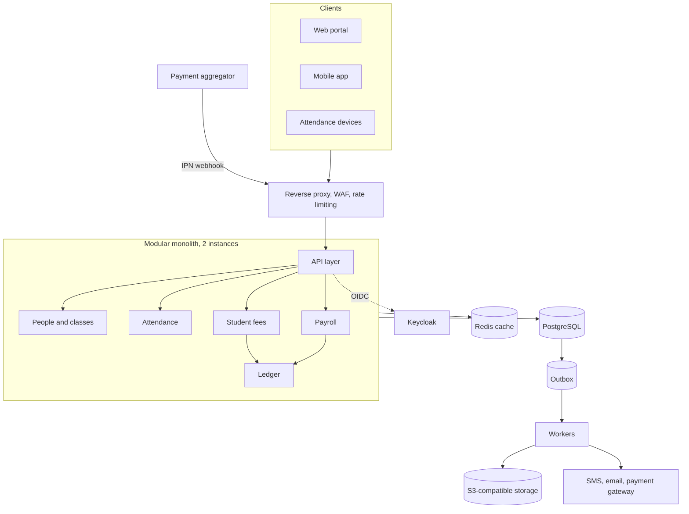
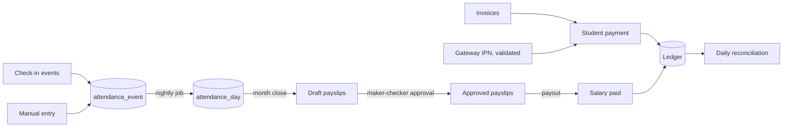
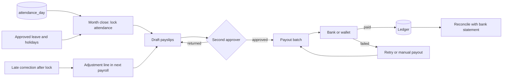
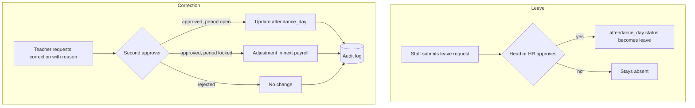
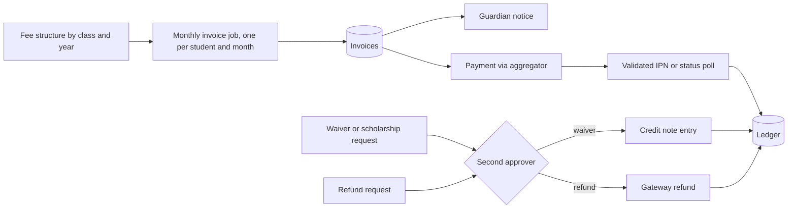

# School and college management system: architecture

One institution, built as a modular monolith on PostgreSQL. It covers attendance for students, teachers and office staff, student fee collection, and teacher and staff payroll.

- 10,000–20,000 students
- 200–500 teachers
- Self-hosted origin
- Single database, no tenant IDs

## How the system fits together

Clients reach one API through a reverse proxy. Business data and background events are written in the same database transaction, and workers handle everything slow or external.

## Attendance, fees and payroll

Attendance is stored as raw events and summarised daily. Payroll reads the daily summary, and every money movement posts to one immutable ledger.

## Month close, payroll and payout

Payroll reads a locked attendance period, never raw clock-ins. A payslip needs a second approver, and a failed payout stays unpaid until it is retried. Corrections after the lock become adjustments in the next payroll instead of rewriting a paid month.

## Leave and attendance corrections

Approved leave changes a day’s status so it isn’t counted as an absence. Corrections need a reason and a second approver, and every outcome is written to the audit log.

## Invoices, waivers and refunds

The invoice job runs once per student and month, so a rerun can’t bill anyone twice. Payments are confirmed by a validated IPN or a status poll. Waivers and refunds need a second approver and post to the same ledger as payments.

## Decisions

| Area | Choice | Reason |
| --- | --- | --- |
| Architecture | Modular monolith, 2 app instances | One institution at this scale doesn’t need microservices. Strict module boundaries keep extraction possible later. |
| Database | PostgreSQL, partitioned by academic year | Transactions for money, about 25M period-attendance rows a year at 20k students, point-in-time recovery. |
| Events and jobs | Outbox table plus worker | Notifications and PDFs commit atomically with the data and retry safely. Scheduled jobs use advisory locks. |
| Search | Postgres full-text and `pg_trgm` | OpenSearch is added only if a Bangla search spike fails. |
| Identity | Keycloak over OIDC | MFA for admin, finance and HR. Phone OTP for guardians and students. Fine-grained permissions stay in the app. |
| Payments | One aggregator integration | Session, hosted payment page, then a validated IPN webhook processed idempotently. |
| Money | Integer amounts, double-entry ledger | Corrections are reversing entries. Payroll, refunds and waivers need a second approver. |
| Files | S3-compatible object storage | Receipts, payslips and report cards served by short-lived signed URLs. Backups kept off-site. |

## Still to confirm

- Whether the institution must collect fees through a specific government gateway, which would decide the payment integration.
- Whether hosting is fully on-premises or an on-premises origin behind Cloudflare.
- How attendance is captured: manual entry, RFID or QR cards, or biometric devices.
- Bangla search quality on real names and notices, tested in a one-week spike.
- Which payout format your bank supports for bulk salary payments.
- The institution’s leave and holiday rules, which decide how absences are counted.